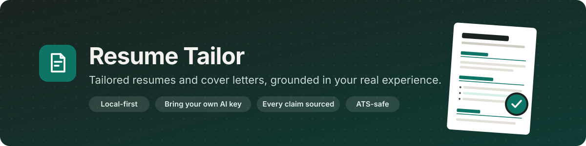
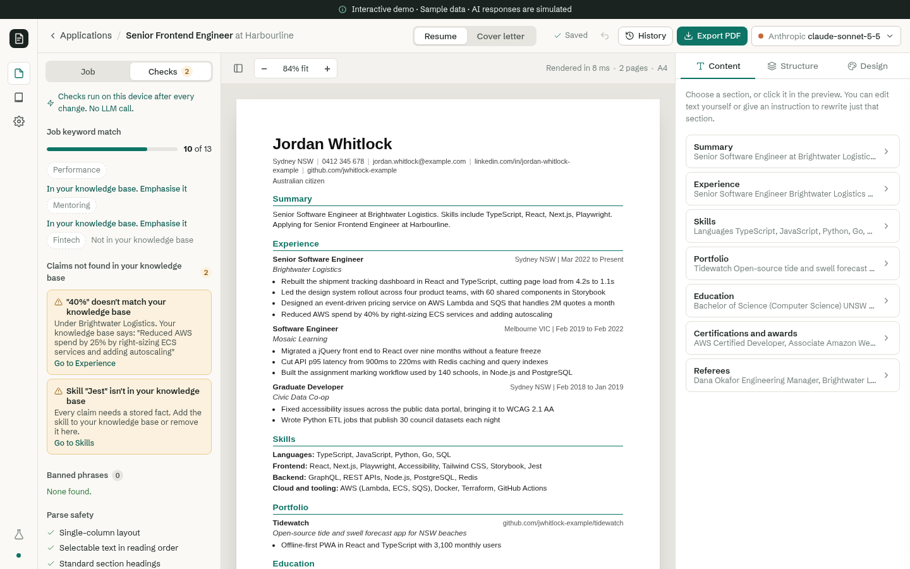
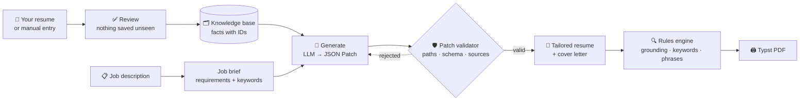
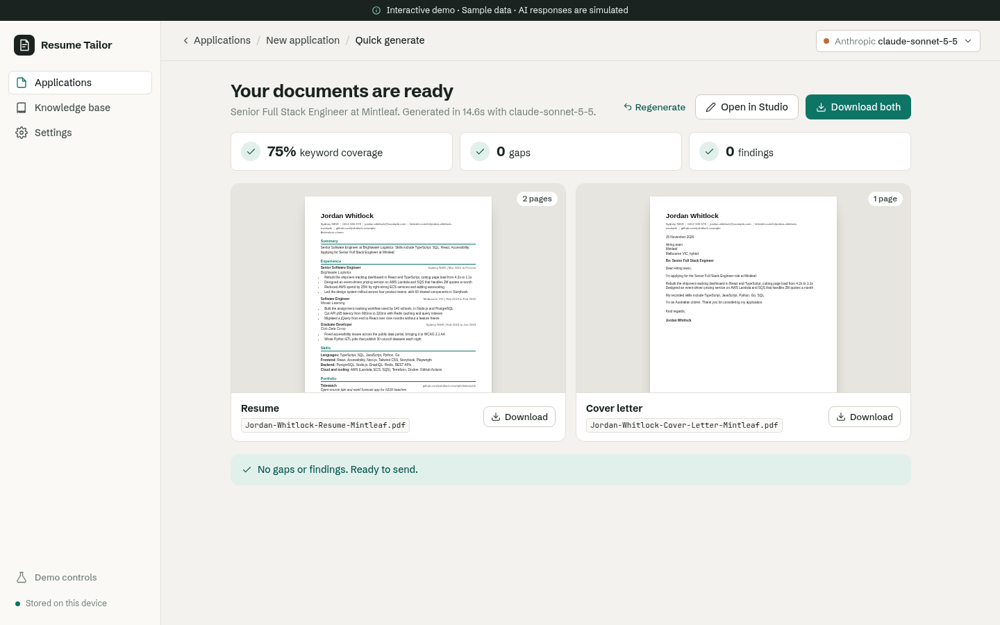

<p align="center">
  
</p>

<p align="center">
  
  
  
  
  
</p>

<p align="center"><b>Paste a job ad. Get a tailored, ATS-safe resume and cover letter, written only from facts you have actually recorded.</b></p>

<p align="center">
  
</p>

## 💡 The problem

AI resume writers are fast, but they **make things up**: inflated numbers, tools you've never used, generic filler. Recruiters notice, and so do interviewers.

Resume Tailor treats your career history as a **knowledge base of facts**. Every generated bullet carries the ID of the fact it came from, and a local rules engine flags anything that doesn't trace back.

## ✨ Highlights

| | |
|---|---|
| 🔗 **Every claim traceable** | Bullets reference a stored highlight ID. Numbers or technologies that aren't in your record are flagged before you export. |
| 🎯 **Surgical AI edits** | Rewrite one section with a plain instruction. The model returns RFC 6902 JSON Patch ops, checked against a path whitelist and schema, and shown as a word-level diff you accept or reject. |
| ⚡ **Design is free** | Fonts, spacing and colour go straight to the renderer: no LLM call, no tokens, re-rendered in under 300 ms. |
| 🔐 **Your key, your machine** | Bring your own Claude, GPT or Gemini key, encrypted with AES-GCM in the browser. Calls go browser → provider directly. Data lives in a local SQLite file. |
| 🧾 **ATS-safe output** | Single-column Typst PDFs with selectable text in reading order, plus honest parse-safety checks. No made-up "ATS score". |
| 🕓 **Nothing is lost** | Autosave, per-document revision history, restore and undo. |

## 🧭 How it works



Two ways in:

- **⚡ Quick generate**: paste a job ad and watch a five-stage pipeline (read → match → write → fit pages → check) produce finished PDFs in about 15 seconds. Gaps are flagged, never blocking.
- **🎛️ Studio**: review the extracted brief, choose which experience to draw on, then edit section by section.

<p align="center">
  
</p>

## 🧰 Tech stack

| Layer | Choice |
|---|---|
| App | Next.js (App Router), TypeScript strict, Tailwind CSS v4, shadcn/ui |
| Data | SQLite via libSQL, Drizzle ORM, Zod validation everywhere |
| AI | Vercel AI SDK, called client-side with structured outputs (Anthropic, OpenAI, Gemini) |
| Editing | fast-json-patch, Zustand, dnd-kit |
| Rendering | Typst compiled to WASM in a Web Worker |
| Testing | Vitest, Testing Library, Playwright with a deterministic mock provider |

## 📍 Status

> 🚧 **Design complete, implementation in progress.** The product is fully specified and prototyped. The production app is being built in public, milestone by milestone.

- [x] Product and build specification ([`docs/SPEC.md`](docs/SPEC.md))
- [x] Interactive mock covering every flow, with simulated AI ([`mock/`](mock/))
- [ ] Scaffold, schemas and SQLite (M0–M1)
- [ ] Typst rendering spike (M2)
- [ ] Knowledge base, onboarding and resume import (M3)
- [ ] Provider connections, Studio, Workspace and checks (M4–M7)
- [ ] History, export, Quick generate and backup (M8–M10)
- [ ] Open-source release and public Vercel demo (M11)

## 🚀 Try the mock

No install and no API key. It runs straight from the file system:

```sh
git clone https://github.com/Suman196pokhrel/instant-resume.git
cd instant-resume
xdg-open mock/index.html   # macOS: open mock/index.html
```

Uses synthetic sample data. AI responses are simulated, and **Demo controls** in the sidebar show the empty, error and gap states.

## 📂 Repository

```
docs/SPEC.md   single source of truth: scope, architecture, schemas, flows, tests
mock/          static interactive demo (HTML, CSS, vanilla JS)
AGENTS.md      entry point for AI coding agents
```

## 🤝 Contributing

Read [`docs/SPEC.md`](docs/SPEC.md) first. It defines what to build, in what order, and when it's done. Keep fixtures synthetic, and update the spec and mock alongside any behaviour change.

<sub>No licence has been chosen yet; one will be added before the first release.</sub>
