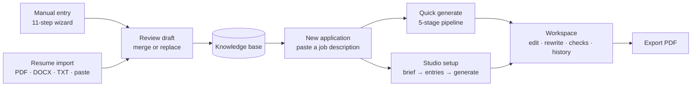
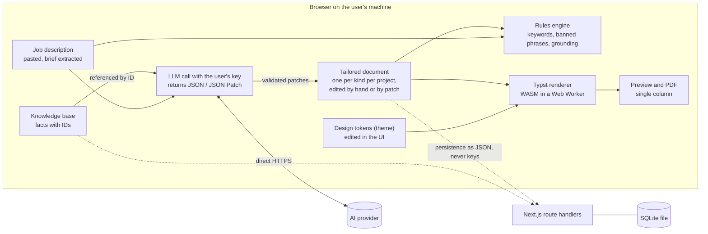
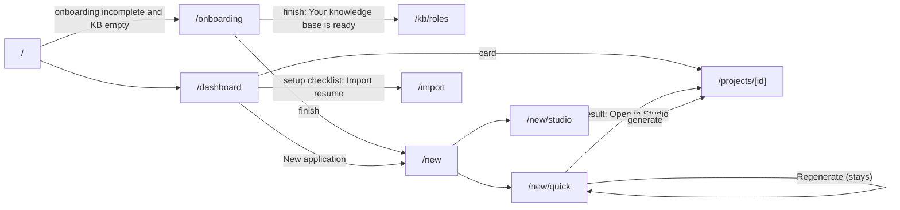

# Instant Resume: Product and Build Specification

> **The single source of truth for this repository.** Product scope, platform decisions, implementation details, design system, flows, tests and acceptance criteria are all here. No other document overrides it. `mock/` is a working reference for interactions and visual details: when this document is silent, match the mock. When the mock and this document disagree, this document wins; fix the mock or record the decision here.
>
> Updated 15 November 2026. Replaces `CURRENT_SCOPE.md`, `BUILD_SPEC.md` and `MVP_OVERVIEW.md` (and its PDF), which remain in Git history.

**Before you start:** read §1 (scope and modes), §19 (build order) and §20 (definition of done). Build milestones M0–M11 in order. Read §23 for repository rules.

---

## Contents

1. Product scope and operating modes
2. Glossary (use these words exactly)
3. Locked decisions and tech stack
4. Architecture
5. Project structure
6. Data model and schemas
7. Database and API routes
8. LLM layer: providers, keys, contract, prompts
9. Rendering: Typst templates, preview, export, page fitting
10. Rules engine (checks)
11. Design system: colour, type, spacing, components
12. Motion and animation
13. Screens, routes and navigation
14. Flows in detail
15. UI copy rules and key strings
16. Accessibility
17. Seed data and fixtures
18. Testing plan
19. Milestones and build order
20. Acceptance criteria (definition of done)
21. Out of scope
22. Open decisions (defaults chosen, flagged for the owner)
23. Repository, mock and documentation rules

---

## 1. Product scope and operating modes

### 1.1 Goal

**Instant Resume** is a source-available, locally hosted, bring-your-own-key (BYOK) web app. It turns a pasted job description into an ATS-friendly resume and cover letter, grounded only in facts the user entered once into a knowledge base. It solves one narrow problem: preparing tailored application documents from stored experience. It does not find jobs, submit applications or manage a hiring pipeline.

- Runs on the user's own machine or a private server the user controls (`pnpm dev`, local SQLite file). The user's own AI provider keys; the user pays the provider directly.
- **Local-first is the first-stage target.** There is no hosted platform and no Instant Resume API between the user and their AI provider. Any hosted offering would need an explicit revision of this spec first.
- Source on a public GitHub repository, built in public.
- A Cloudflare Worker hosts only a **simulated** public demo (§1.5), plus its visitor-feedback collector.
- No subscription, billing, accounts, managed real-user backend or live public AI service.

Users build the knowledge base by manual onboarding or by importing an existing resume and reviewing the extracted details before saving. Then, for each job, there are two ways to create documents:

- **Quick generate (primary):** paste a job description, watch a 5-stage pipeline, get finished PDFs. Gaps and findings are flagged but never block the download.
- **Studio (manual):** review the job brief, choose which knowledge base entries to use, generate, then edit in the Workspace: edit text by hand, rewrite one section with an instruction, reorder or hide sections, adjust the design, review checks, browse history, export.

Core principles (these shape every decision):

1. **Every claim traces to a stored fact.** Bullets carry the ID of the highlight they came from. The rules engine flags anything ungrounded. Source IDs and heuristic checks are safeguards, not proof that every sentence is correct; users review generated claims. Never promise a universal "ATS score" or interviews.
2. **Formatting costs zero tokens.** Design and structure changes never call the LLM and re-render in under 300 ms.
3. **Small edits stay small.** A rewrite sends one section and gets back JSON Patch operations for that section only. The user sees a diff and accepts or rejects.
4. **The API key never leaves the browser** except to the provider. LLM calls go browser → provider directly. Local storage does not mean offline AI: the relevant input goes to the user's selected provider, and the UI must say so.
5. **Everything saves automatically**, with revision history and undo.

Deliverables: a working local Next.js application with public GitHub source and reproducible setup, and a separately deployed simulated public demo. Each meets its own criteria in §18 and §20; neither substitutes for the other.

### 1.2 Two operating modes

| Capability | Real local application | Public demo (current `mock/`) |
|---|---|---|
| Runtime | Local Next.js server installed by the user | Static HTML/CSS/JS served by a Cloudflare Worker; its only server code is the visitor-feedback endpoint (§1.5) |
| Provider access | User's own API keys; real requests to the chosen provider | Simulated only; no real key entry or provider calls in the public release |
| Resume import | Real PDF/DOCX/TXT extraction into a review draft | PDF/DOCX show labelled **sample** extraction; TXT and pasted text use a basic local parser |
| Generation and rewrites | Schema-validated provider responses with evidence references | Fixtures or deterministic transformations, visibly labelled simulated |
| Editing and design | Interactive, persisted locally, with history | Interactive, persisted in the visitor's browser, with history |
| Data | Local SQLite plus encrypted on-device key storage | Synthetic sample data and browser-local state; no cloud database |
| Rendering and export | Typst worker; downloadable PDFs | HTML preview; Workspace export opens the browser print dialog; Quick generate result downloads are simulated (toast only, no file). Never claim Typst compilation |

Sections on real providers, encryption, SQLite, API routes, Typst and the Next.js stack apply to the real app unless stated otherwise. Mock timings, model names, key masks and generated text are fixtures, not proof of an integration. Verify supported model IDs and current SDK APIs against official documentation during implementation; never copy mock identifiers.

The browser-direct LLM design requires the browser to stay open during generation. The rendering Web Worker is not a durable background job service. Durable background execution would need an explicit architecture revision covering where keys and job state live; document that before changing the design.

### 1.3 Primary flow



1. Build the knowledge base manually, or upload a resume / paste its text.
2. Review, correct and confirm contact details, employment, volunteer work, portfolio items, education, skills, credentials, referees and additional sections.
3. From Applications, start a new application for a pasted job description. Choose Quick generate or Studio.
4. Edit the resume and cover letter, inspect checks, adjust layout, review history, export.
5. Reopen saved applications; maintain or back up the knowledge base.

Main navigation has exactly three items: **Applications, Knowledge base, Settings**. The dashboard is a list of saved application documents, not a job-search CRM.

### 1.4 Knowledge base and import rules

- Nothing from an import is saved to the knowledge base before the user reviews it. Missing facts stay blank; never infer work rights or invent fields.
- Unrecognised sections are kept as Additional sections, never silently discarded. The original resume text is kept as a reference-only additional section and is never automatically included in documents.
- Review offers two explicit save modes: **merge** (add entries; keep existing contact and work-rights details) or **replace** (replace the knowledge base). Existing application documents are always preserved. A draft import can be abandoned without changing the saved KB. Confirm before replacing an unfinished onboarding draft. In the demo, replacing the sample KB is selected by default.
- Importing a resume is distinct from restoring a JSON backup (§14.6).
- Paid experience is never required. Volunteer-only and education-only backgrounds must work through both generation flows.
- Manual entry and import feed the same knowledge base and the same document workflows.
- Real extraction (PDF/DOCX/TXT through the user's provider, OCR, extraction accuracy) is implementation work (M3a), not a mock capability. Explain provider data transfer before extraction. Details: §14.1a.

### 1.5 Public demo

Visitors explore sample career information and sample job descriptions, choose Quick generate or Studio, review simulated results, edit text and layout, inspect checks and history, and try export. They need no account, API key, payment or installation.

- A visible notice on every screen: **"Interactive demo · Sample data · AI responses are simulated"** (implemented in the mock).
- Generation, extraction and AI rewrite proposals may use fixtures or deterministic transformations. Manual edits, history, local saving and rendering stay genuinely interactive; there is no need to prebuild every edited document.
- Uploaded content stays in the browser. Make that distinction from real provider processing explicit.
- **Before public deployment (not yet done):** disable real API-key collection and live-provider paths (including the Settings "How to get an API key" guide, which must point to local setup instead of asking visitors to paste a key), make reset easy to find, explain browser-local storage, keep personal uploads optional with a sample-first path, and link to the source repository and local setup once they exist. Never label the mock a fully implemented AI product.

- **Visitor feedback** (owner decision 2026-11-17, ported from the Sambad demo): "Give feedback" in the demo strip opens a non-modal panel (usefulness 1–5, topics, note, "Point at it" to attach any on-screen element, optional role and email). Entries are saved in the browser first (`instant-resume-feedback-v1`, kept by "Reset all demo data"), then sent to the Worker's `/feedback`, which verifies a Turnstile token, validates, rate-limits and stores them in D1 with only a salted IP hash. Opened from `file://` nothing is sent; Demo controls → "Feedback on this device" reviews and exports it. Details: `mock/feedback-worker/README.md`.

Delivery rules: §3.1. Release checks: §18.5. Acceptance: §20.

### 1.6 Engineering boundaries

CI, reproducible local setup, validated AI outputs, useful error handling and evaluation support the one user problem. Public multi-tenant infrastructure, remote workers, always-on jobs and cloud databases are not needed, including for the demo. The one exception is the demo's visitor-feedback collector (§1.5, owner decision 2026-11-17). Do not add any other cloud infrastructure, auth, billing or background services for the demo, and do not add product features to justify infrastructure.

### 1.7 Current status

| Item | Status |
|---|---|
| This specification | Current |
| `mock/` static interactive demo | Exists; matches this spec's flows with simulated AI |
| Real Next.js application | M0 scaffold in progress (§19) |
| GitHub publication | Public repository; licensed under PolyForm Noncommercial 1.0.0 (`LICENSE`) |
| Public demo deployment | `mock/` live on Cloudflare at https://instant-resume-demo.spokhrel196.workers.dev with visitor feedback (Turnstile key pending); pre-deployment items in §1.5 pending |
| Custom domain | Optional; a hosting-provided address is sufficient |

---

## 2. Glossary (use these words exactly)

Use one word per thing in code, UI and tests.

| Term | Meaning | Code name |
|---|---|---|
| Knowledge base (KB) | Every fact about the user, entered once | `KnowledgeBase` |
| KB entry | One fact with an ID: role, portfolio item, education, skill group, credential, referee | `KbEntry` |
| Highlight | One achievement with optional metric; the source for resume bullets | `Highlight` |
| Portfolio item | A personal, academic or work project the user built. **Never call this a "project".** | `PortfolioItem` |
| Credential | Certification, award, publication or patent | `Credential` |
| Job description (JD) | Raw text the user pastes | `jdText` |
| Job brief | Structured extraction from the JD | `JobBrief` |
| Project | Workspace for one target job | `Project` |
| Document | A resume or a cover letter inside a project | `Document` (`kind: 'resume' \| 'coverLetter'`) |
| Section | Titled part of a document (Summary, Experience…) or one cover letter paragraph | `Section` |
| Section item | One item inside a section; points to KB entries by ID | `SectionItem` |
| Bullet | One line under a section item, written from a highlight | `Bullet` |
| Theme | Design token values for a document | `Theme` |
| Template | Typst layout turning document + theme into a PDF | `Template` |
| Revision | Saved snapshot of a document | `Revision` |
| Connection | Provider + encrypted API key + chosen model | `Connection` |
| Generation | First full run that creates a project's documents | |
| Rewrite | LLM change to one section, guided by an instruction | |
| Instruction | The user's request for a rewrite ("more concise") | |
| Patch | JSON Patch operations returned by the LLM | |
| Prompt | Full text sent to the LLM. **Internal only, never a UI label.** | |
| Edit | Manual text change (no LLM) | |
| Adjustment | Theme change (no LLM) | |
| Check | Rules-engine run; each issue is a **finding** | |
| Gap | A must-have requirement with no supporting KB evidence | |
| Render / Export | Typst compile to preview / save PDF to disk | |
| Studio / Workspace | The manual editing screen (`/projects/[id]`) | |
| Application | User-facing name for a saved target-job workspace (the `Project` data entity), not a submission/status tracker. The mock uses this label consistently. | `Project` |

Screens and regions: App shell, Sidebar, Dashboard, Project card, Empty state, Onboarding wizard, KB screen, Settings, Workspace, Job panel, Checks panel, Preview, Document tabs, Inspector (Content / Structure / Design tabs), Instruction box, Model picker, History drawer.

---

## 3. Locked decisions and tech stack

| Concern | Choice |
|---|---|
| Source and collaboration | Public GitHub repository; build in public |
| Public demo host | Cloudflare Worker with static assets (`mock/feedback-worker/`); simulated demo, no provider secrets; a D1 database holds visitor feedback only |
| Framework | Next.js (App Router), TypeScript strict mode |
| Runtime target | Local machine first (`pnpm dev`, or `pnpm build && pnpm start`), or a private self-hosted server for a single user. The app has no accounts: by default it only accepts connections from the same computer, and a self-hosted instance must use the password lock (§4.1) and be served over HTTPS (Web Crypto key storage needs a secure context; `localhost` already is one). Cloudflare hosts only the separately built/static simulated demo. Real-user cloud hosting and sync are out of scope. |
| Database | SQLite via libSQL (`@libsql/client`), file `./data/instant-resume.db`, accessed only on the server (route handlers and server components). The browser never touches the database: every write goes through a `/api/*` route that validates the whole body with Zod, sits behind the §4.1 access check, and rejects a foreign `Origin` with 403 |
| ORM | Drizzle ORM + drizzle-kit migrations |
| Validation | Zod for every schema: DB JSON columns, API bodies, LLM outputs |
| Forms | React Hook Form + Zod resolver |
| Editor state | Zustand (one store per open project; see 14.5) |
| UI | shadcn/ui core components (Base UI primitives), Tailwind CSS v4, themed with the tokens in section 11. Use vetted 21st.dev components only where shadcn lacks one. Motion: shadcn components keep their built-in animations (`tw-animate-css`) as shipped; a shared component gets custom CSS motion only where the mock calls for it (section 12). Page, step and document transitions use React's `<ViewTransition>` (React 19.3; it drives the browser's View Transitions API). No Framer Motion or other JS animation libraries. |
| Drag and drop | native HTML5 drag and drop, as the mock (keyboard: Alt+Arrow and the row buttons; no touch drag) |
| LLM | Vercel AI SDK v7, client side: `ai`, `@ai-sdk/openai`, `@ai-sdk/anthropic`, `@ai-sdk/google`. `generateObject` is deprecated in v7: the adapter calls `generateText` with `output: Output.object({ schema })` and Zod schemas. Large schemas use `jsonInPrompt` instead (§8.1). |
| Patching | RFC 6902 subset applied in `lib/patch/validate.ts` (only the whitelisted ops; no library) |
| PDF | Typst via typst.ts (WASM) in a Web Worker, lazy-loaded on the Workspace and Quick generate pages only |
| Key encryption | Web Crypto API, AES-GCM, non-extractable key in IndexedDB (see 8.2) |
| Fonts (UI) | Schibsted Grotesk via `next/font/google` |
| Fonts (documents) | Liberation Sans, Carlito, Inter (open licences), bundled as TTF in `public/fonts/` and loaded into Typst |
| Toasts | sonner (shadcn's toast) |
| Tests | Vitest + Testing Library (unit, component, route handlers). Playwright for end-to-end (recommended addition; see 18). |
| Package manager | pnpm |

Conventions: Australian by default (A4, AU spelling, work rights line, referees section), configurable in Settings (A4/Letter, Australian/US).

Layout: **single column only** for ATS safety. **One** resume template and **one** cover letter template in the MVP.

---

### 3.1 GitHub and demo delivery requirements

- GitHub is the source/collaboration destination. Publish code, versioned docs, synthetic fixtures, tests and reproducible local setup.
- Licence: **PolyForm Noncommercial 1.0.0** (`LICENSE`, with the owner's `Required Notice:` line). Free for personal and other noncommercial use, modification and redistribution; preparing one's own resume and job applications counts as personal use. Commercial use, including selling copies or modified versions, requires a separate paid licence from the owner. Call the project "source-available", never "open source" (the licence is not OSI-approved). Do not change the licence without the owner.
- The Cloudflare deployment (`cd mock/feedback-worker && npx wrangler deploy`) serves **only `mock/`** as static HTML/CSS/JavaScript; `mock/.assetsignore` keeps the Worker folder out. Keep docs, local data, key stores and development configuration out of the deployment artifact. No Next.js route handlers or live LLM functions; the only server code and database are the feedback collector.
- Use a Git-connected deployment workflow with checks before production promotion; preview deployments can support review. Do not deploy every change directly to the public demo without validating it.
- If the mock is later replaced by a demo build of the real UI, provide a separate static/demo target with mock provider and browser persistence adapters. A runtime toggle alone must not enable live providers on the public deployment. Never deploy the full local server under the assumption that setting one mock-provider flag removes its database/API dependencies.
- Public demo: immediately visible simulation notice, sample-first entry, no login/key/payment requirements, reset action, clear local-storage behavior, and links to GitHub/local setup once available. All examples must be synthetic. Uploaded content stays in the browser in this mode; make that distinction explicit from real provider processing.
- Hosted demo settings may demonstrate provider selection, but must disable real key collection and real connection tests. The current mock's editable connection form needs this public-release adjustment; it is not completed by this specification update.
- The Worker `instant-resume-demo` and D1 database `instant-resume-feedback` exist on the owner's Cloudflare account. Public repository URL and a custom domain are not configured by this document. A custom domain is optional. Add actual links only after publication; publishing and deploying remain separate authorized tasks.
- CI uses fixture/mock providers and no personal API keys. Real-provider checks are opt-in local verification, documented separately from the deterministic CI suite. Do not claim passing fixture tests prove provider connectivity or output quality.

---

## 4. Architecture

Four layers keep content, design and checks apart, so the LLM only ever patches the tailored document.



Request boundaries:

- **Browser → Next.js route handlers:** all persistence (KB, projects, documents, revisions, settings). JSON over `fetch`. No API keys ever.
- **Browser → LLM provider:** directly, using the decrypted key in memory only for the duration of the call.
- **Browser → Web Worker:** Typst compile. The worker holds the WASM compiler, fonts and templates.

Security: `proxy.ts` sets a strict Content-Security-Policy on every page with a fresh nonce per request (Next.js needs a few inline scripts, and the nonce allows only those): `script-src 'self' 'nonce-…' 'strict-dynamic' 'wasm-unsafe-eval'` (plus `'unsafe-eval'` in development only), never `'unsafe-inline'` for scripts; `connect-src 'self' https://api.openai.com https://api.anthropic.com https://generativelanguage.googleapis.com`; `worker-src 'self' blob:`; `style-src 'self' 'unsafe-inline'` (React style attributes and runtime styles); `frame-ancestors 'none'`; no `upgrade-insecure-requests`, because the app is served over `http://127.0.0.1`. Nonces need per-request rendering, so the root layout awaits `connection()` and Cache Components/PPR stay off. No third-party scripts. Pin dependency versions.

### 4.1 Access (single-user lock)

The real app has one user per install and no accounts. The KB holds personal details, including referees' contact details, so nobody else may reach it. API keys are not at risk on the server (they never leave the browser that stored them); everything else is. Two modes:

| Mode | When | Behaviour |
|---|---|---|
| **Local only** (default) | `APP_PASSWORD` unset | `pnpm dev` and `pnpm start` listen on `HOST`, default `127.0.0.1`, so only this computer can connect. No password, no unlock screen. |
| **Password lock** | `APP_PASSWORD` set | For a private server reached from other devices. Every page and every `/api/*` route needs a session; pages redirect to `/unlock`, API calls get `401 {"error":"locked"}`. |

Rules:

- **Unsafe setups refuse to start.** A startup check (Next.js `instrumentation.ts`) exits with a clear message if `HOST` isn't a loopback address and `APP_PASSWORD` is unset, or if `APP_PASSWORD` is shorter than 12 characters.
- **Password check:** hash `APP_PASSWORD` with scrypt at startup and compare with `timingSafeEqual`. Never log it or send it back to the client.
- **Session:** on success, set the cookie `ir_session` (`HttpOnly`, `Secure`, `SameSite=Strict`, `Path=/`, `Max-Age` 30 days). Its value is an expiry time signed with HMAC-SHA-256. The signing key is derived from a random secret stored at `./data/session-secret` (created on first start, never committed or backed up) together with the password hash, so changing `APP_PASSWORD` signs out every device. Stateless, so there's no sessions table.
- **Gate:** the request middleware (`middleware.ts`; newer Next.js versions call it `proxy.ts`, so check the installed version) checks the cookie on every request except `/unlock`, `POST /api/unlock` and static assets.
- **Rate limit:** 5 failed attempts per client address within a minute → `429` and "Too many attempts. Try again in a minute." An in-memory counter is enough for one server process.
- **Cross-site requests:** besides `SameSite=Strict`, state-changing API requests must carry an `Origin` header matching the app's own origin, or get `403`.
- **HTTPS is required in password mode.** The `Secure` cookie and the browser's key storage both need it. Recommend a reverse proxy with TLS, or better, a private network (Tailscale, WireGuard, Cloudflare Access) so the app is never public at all.
- **No accounts, sign-up, profile or password reset.** Resetting means setting a new `APP_PASSWORD` and restarting, which only the server's owner can do. Each device adds its own API key, because keys never leave the browser that stored them.
- The public demo is static and needs none of this; the mock simulates it behind a Demo controls switch (§23.2).

---

## 5. Project structure

```
instant-resume/
  app/
    layout.tsx                 # fonts, Toaster, global CSS
    page.tsx                   # redirect: onboarding incomplete → /onboarding, else /dashboard
    (focus)/onboarding/manual/page.tsx # full-screen manual wizard and review (own top bar)
    (shell)/layout.tsx         # App shell: sidebar + top bar + model picker
    (shell)/onboarding/page.tsx# chooser: import or manual (in the shell, as the mock)
    (shell)/import/page.tsx    # upload/paste, extraction and review handoff
    (shell)/dashboard/page.tsx
    (shell)/kb/[section]/page.tsx
    (shell)/settings/page.tsx
    (shell)/new/page.tsx       # chooser
    (shell)/new/quick/page.tsx # Quick generate
    (shell)/new/studio/page.tsx# Studio setup (JD → brief → entries → generate)
    (shell)/projects/[id]/page.tsx  # Workspace (compact sidebar)
    api/…                      # route handlers (section 7)
  components/
    ui/                        # shadcn components
    shell/ (Sidebar, TopBar, ModelPicker, DemoBanner)
    dashboard/ kb/ onboarding/ settings/ new/ quick/ workspace/ (JobPanel, ChecksPanel, Preview, Inspector, ContentTab, StructureTab, DesignTab, HistoryDrawer, ExportDialog, ProposalCard)
  lib/
    schemas/                   # Zod: kb.ts, brief.ts, document.ts, theme.ts, project.ts, settings.ts
    db/                        # drizzle schema.ts, client.ts, migrations/, seed.ts
    llm/                       # providers.ts, adapter.ts, mock-provider.ts, prompts/, contract.ts
    patch/                     # validate.ts (allowed paths), apply.ts
    generate/                  # skeleton.ts, pipeline.ts (Quick generate event emitter)
    checks/                    # rules engine
    render/                    # worker.ts, client.ts, templates/resume.typ, templates/letter.typ, fit.ts
    crypto/                    # keystore.ts
    text/                      # diff.ts, filename.ts, keywords.ts
    stores/                    # zustand stores
  public/fonts/                # LiberationSans-*.ttf, Carlito-*.ttf, Inter-*.ttf
  tests/
    unit/ component/ api/ e2e/ fixtures/
  data/                        # gitignored; SQLite file lives here
  drizzle.config.ts  vitest.config.ts  playwright.config.ts
```

Scripts: `dev`, `build`, `start` (`dev` and `start` bind to `HOST`, default `127.0.0.1`; see §4.1), `db:migrate`, `db:seed` (loads the sample KB from section 17), `test`, `test:e2e`, `lint`, `typecheck`.

---

## 6. Data model and schemas

All records carry `schemaVersion: 1`. On load, run a migration step keyed on `schemaVersion` (a no-op for v1, but the hook must exist). Write these as Zod schemas in `lib/schemas/` and derive TypeScript types from them.

### 6.1 Knowledge base

```ts
Contact      { id: 'kb-contact'; name; email; phone?; location; linkedin?; github? }
WorkRights   { id: 'kb-rights'; status: WorkRightsStatus; noticePeriod?; notes? }
WorkRightsStatus = 'Australian citizen' | 'Permanent resident' | 'New Zealand citizen'
                 | 'Temporary visa with full work rights' | 'Temporary visa with limited work rights'
                 | 'Requires sponsorship'
Highlight    { id; text; metric?; skills: string[]; evidenceFor?: string }  // skills: tags for matching; evidenceFor: the job requirement it was added for (14.3)
Role         { id; title; company; location?; start; end; highlights: Highlight[] }  // start/end free text "Mar 2022", "Present"
PortfolioItem{ id; name; summary; link?; highlights: Highlight[] }
Education    { id; degree; institution; year?; notes? }
SkillGroup   { id; group; items: string[] }
Credential   { id; kind: 'Certification'|'Award'|'Publication'|'Patent'; title; issuer?; year? }
Referee      { id; name; title?; company?; contact }
VolunteerRole{ id; title; company /* organisation */; location?; start?; end?; highlights: Highlight[] }
AdditionalSection{ id; title; notes; referenceOnly?: boolean }
KnowledgeBase{ schemaVersion; contact; workRights?; roles; volunteering; portfolio; education; skills; credentials; referees; additional }
```

Work rights is optional: the onboarding step can be skipped and it is never inferred (§1.4), so a KB may have none; templates then leave the line out. Volunteer work renders as an experience-style section titled Volunteer work. Additional sections retain their title and content; reference-only original resume text is excluded from automatic selection. Normalise older knowledge bases with empty `volunteering` and `additional` arrays.

IDs are stable strings (`role-…`, `hl-…`, `pf-…`, `ed-…`, `sk-…`, `cr-…`, `ref-…`), generated with a short random suffix. **Never reuse or change an ID**; bullets reference highlight IDs.

### 6.2 Job brief

```ts
JobBrief {
  title; company; location; team?;
  seniority: 'Junior' | 'Mid-level' | 'Senior' | 'Lead';
  requirements: string[];   // must-haves, 3–8 short phrases
  niceToHave: string[];
  keywords: string[];       // 8–15 terms used for coverage checks
  workRights: string;       // what the ad says, or 'Not stated'
}
```

The user can edit title, company, location, team, and add or remove keywords before generating (Studio path).

### 6.3 Documents

```ts
Bullet      { id; text; source: string /* highlight ID, required */ }
SectionItem { id; ref: string /* KB entry ID */; heading; sub?; meta?; line?; bullets?: Bullet[] }
SectionKind = 'summary' | 'experience' | 'skills' | 'portfolio' | 'education' | 'credentials' | 'referees' | 'additional' | 'paragraph'
Section     { id; kind: SectionKind; title; hidden: boolean; text?: string; items?: SectionItem[] }
Theme       { font: 'Liberation Sans'|'Carlito'|'Inter'; baseSize; headingSize; nameSize; margin; lineHeight; sectionGap; accent }
Document    { id; projectId; kind: 'resume'|'coverLetter'; theme: Theme; sections: Section[];
              recipient?: { name; company; location } /* cover letter only */ }
```

Rules:

- `summary` and `paragraph` sections use `text`; the others use `items`.
- Skills items use `heading` (group name) and `line` (comma-separated skills; note that "AWS (Lambda, ECS, SQS)" is one skill, so split on commas outside parentheses).
- Experience items: `heading` = job title, `sub` = employer, `meta` = "Location | Start to End", `bullets`.
- Cover letter: 4 `paragraph` sections titled Opening, Evidence, Fit, Close. The template adds the date, recipient block, "Re: {role}", "Dear {recipient}," and the sign-off "Kind regards, {name}".
- Default resume section order: Summary, Experience, Skills, Portfolio, Education, Certifications and awards, Volunteer work (an `experience`-kind section titled "Volunteer work"), one `additional` section per selected additional KB entry (titled with the entry's title), Referees. Referees always come last by default (Australian convention). Omit sections with no items, except Summary. Users reorder in the Structure tab.

Theme defaults and ranges (Design tab sliders):

| Field | Default | Range | Step | Unit |
|---|---|---|---|---|
| font | Liberation Sans | Liberation Sans / Carlito / Inter | | |
| baseSize | 10.5 | 9–12 | 0.5 | pt |
| headingSize | 12 | 10–15 | 0.5 | pt |
| nameSize | 22 | 16–30 | 1 | pt |
| margin | 18 | 10–25 | 1 | mm |
| lineHeight | 1.35 | 1.1–1.7 | 0.05 | × |
| sectionGap | 12 | 4–24 | 1 | pt |
| accent | #0E7466 | swatches #0E7466, #1F4E8C, #7A2E5C, #8A4B12, #2E2E2E, plus custom picker | | |

Theme presets (Quick generate default theme):

| Preset | font | base | heading | name | margin | lineHeight | gap | accent |
|---|---|---|---|---|---|---|---|---|
| Classic | Liberation Sans | 10.5 | 12 | 22 | 18 | 1.35 | 12 | #0E7466 |
| Modern | Inter | 10 | 12 | 24 | 16 | 1.4 | 14 | #1F4E8C |
| Compact | Carlito | 10 | 11 | 18 | 12 | 1.25 | 8 | #2E2E2E |

### 6.4 Project and revisions

```ts
Project  { id; schemaVersion; company; role; location; jdText; brief: JobBrief; selected: string[] /* KB entry IDs */;
           source: 'studio' | 'quick'; coverLetterOff?: boolean; gaps?: string[];
           notes?: string /* the user's notes for this application: motivation, emphasis, referral */; createdAt; updatedAt }
Revision { id; documentId; ts; kind: 'generation'|'rewrite'|'edit'|'adjustment'|'structure'|'restore';
           label: string; coalesceKey?: string; snapshot: Document }
```

Revision rules:

- Every change creates or updates a revision automatically. There is no save button.
- **Coalescing:** consecutive edits to the same section, or consecutive design adjustments, within 60 seconds update the latest revision instead of adding a new one. Use `coalesceKey` (`edit-{sectionId}`, `title-{sectionId}`, `design`).
- Labels in plain words: "Generated from job brief", `Rewrote Experience: "more concise"`, "Edited Summary", "Adjusted design", "Moved Skills up", "Hid Referees", "Restored the version from Today, 10:42 am", `Undid: Rewrote Experience: "more concise"` (an undo step carries its change's revision label).
- Revisions are coalesced by the server (`PUT /api/documents/:id`): a save whose `coalesceKey` matches the document's latest revision, less than 60 s after it, updates that revision (snapshot, time, label); anything else adds one. Each change keeps its own revision: a waiting save under another key is sent before the next change.

### 6.5 Settings (stored in the DB `settings` table, except connections)

```ts
Prefs { paper: 'A4'|'Letter'; spelling: 'en-AU'|'en-US';
        quick: { theme: 'classic'|'modern'|'compact'; pages: 1|2; coverLetter: boolean; tone: 'Professional'|'Warm'|'Concise' };
        dismissedOnboardingBanner: boolean }
OnboardingState { step: number; maxStep: number; draft: Partial<KnowledgeBase>; completed: boolean;
                  imported?: string; saveMode: 'merge'|'replace' }
ActiveModel { provider: 'anthropic'|'openai'|'gemini'; model: string }   // stored client-side with connections
```

Defaults: A4, en-AU, quick = { classic, 2, true, Professional }.

---

## 7. Database and API routes

### 7.1 Tables (Drizzle, SQLite)

| Table | Columns |
|---|---|
| `kb_entries` | `id` PK, `type` ('contact'\|'workRights'\|'role'\|'portfolio'\|'education'\|'skills'\|'credential'\|'referee'|'volunteering'|'additional'), `position` int, `data` JSON text, `schema_version`, `updated_at` |
| `projects` | `id` PK, `company`, `role`, `location`, `jd_text`, `brief` JSON, `selected` JSON, `source`, `cover_letter_off` bool, `gaps` JSON, `notes` text, `schema_version`, `created_at`, `updated_at` |
| `documents` | `id` PK, `project_id` FK cascade, `kind`, `content` JSON (sections, recipient), `theme` JSON, `updated_at` |
| `revisions` | `id` PK, `document_id` FK cascade, `ts`, `kind`, `label`, `coalesce_key`, `snapshot` JSON |
| `settings` | `key` PK, `value` JSON |

Validate every JSON column with the Zod schema on read and on write. Reject invalid writes with HTTP 422 and a readable message.

### 7.2 Route handlers (all JSON; behind the §4.1 access check when a password is set)

| Method and path | Purpose |
|---|---|
| `POST /api/unlock` | Password mode only: `{ password }` → sets `ir_session`; `401` wrong password, `429` rate limited |
| `POST /api/lock` | Clears `ir_session` ("Lock now") |
| `GET /api/kb` | Whole knowledge base |
| `PUT /api/kb/contact`, `PUT /api/kb/work-rights` | Replace single entries |
| `POST /api/kb/:type` | Add entry (type: roles, volunteering, portfolio, education, skills, credentials, referees, additional) |
| `PATCH /api/kb/:type/:id`, `DELETE /api/kb/:type/:id` | Edit or delete entry |
| `GET/PUT /api/onboarding` | Wizard progress and draft (settings key `onboarding`: step, maxStep, draft, completed, saveMode). PUT gives new entries and highlights their IDs |
| `POST /api/onboarding/complete` | `{ mode }`: validate and save the stored draft. Replace: the draft becomes the KB. Merge: keep existing contact/work rights, add entries whose IDs aren't there yet. Returns `{ added }`; marks complete and clears the draft |
| `GET /api/projects` | List: id, company, role, location, updatedAt, keyword match counts |
| `POST /api/projects` | Create with brief, selected, documents and initial revisions in one transaction |
| `GET /api/projects/:id` | Project, both documents, revisions |
| `PATCH /api/projects/:id` | Rename or update brief |
| `DELETE /api/projects/:id` | Delete (UI offers Undo for 6 s by delaying the call or by re-creating) |
| `POST /api/projects/:id/duplicate` | Duplicate project |
| `PUT /api/documents/:id` | Save content and theme; body includes the revision to append or coalesce |
| `GET /api/documents/:id/revisions` | Revision list |
| `GET/PUT /api/settings` | Prefs |
| `GET /api/backup` | Export `{ app:'instant-resume', schemaVersion, exportedAt, knowledgeBase, projects:[…with documents and revisions], prefs }`. **Never includes connections or keys.** |
| `POST /api/backup` | Import; validate fully, then replace the KB and projects in one transaction |

Saving from the client: debounce document saves by 600 ms. Show "Saving" then "Saved" in the Workspace bar. On a failed save, show a toast "Couldn't save your changes. Retrying…" and retry with backoff.

---

## 8. LLM layer

### 8.1 Providers and models

| Provider | Key prefix | Models shown in picker |
|---|---|---|
| Anthropic | `sk-ant-` | `claude-sonnet-5-5`, `claude-opus-5-5`, `claude-haiku-5-5` |
| OpenAI | `sk-` | `gpt-6.2-sol`, `gpt-6.2-astra`, `gpt-6-luna` |
| Gemini | `AIza` | `gemini-3.8-flash`, `gemini-3.1-pro-preview` |

IDs checked against each provider's model page on 2026-11-18; the first is the default. Models change often, so the lists live in one file (`lib/llm/providers.ts`), and the key test keeps only the ones the key's models list still offers (§8.2). One adapter interface (`lib/llm/adapter.ts`) hides the providers; `name` names the call (`brief`, `match`, `generate`, `rewrite`, `extract`) so the mock can pick its fixture:

```ts
interface LlmAdapter {
  generateObject<T>(args: { name: string; schema: ZodType<T>; system: string; prompt: string; signal?: AbortSignal }): Promise<{ object: T; usage: { inputTokens: number; outputTokens: number } }>;
}
```

**Large schemas** (`jsonInPrompt: true`, used by resume extraction): Anthropic compiles strict structured output into a grammar with a size limit ("The compiled grammar is too large…"), and Sonnet and Opus 5.5 refuse the forced-tool alternative. For these calls the adapter puts the JSON Schema in the system prompt, takes the outermost `{…}` from the answer and validates it with the same Zod schema, with the same single retry. `maxOutputTokens` raises the output budget for long answers (the Anthropic SDK defaults to 4096 for model IDs it doesn't know).

Browser-direct calls: Anthropic needs the header `anthropic-dangerous-direct-browser-access: true` (the SDK doesn't add it). All three providers accept browser calls; the opt-in check is `ANTHROPIC_API_KEY=… OPENAI_API_KEY=… GEMINI_API_KEY=… pnpm test:e2e tests/e2e/cors.spec.ts`, which makes one structured call per provider from Chromium through `/dev/llm` and confirms every listed model ID still exists. If a provider can't be called from the browser, report it; don't proxy keys through the server.

**Mock provider:** `createMockAdapter` (`lib/llm/mock.ts`), enabled when `NEXT_PUBLIC_LLM_MOCK=1` (inlined at build time; the e2e build sets it). It returns deterministic fixtures keyed by call `name` after a 2 s delay, validated with the call's schema like a real answer, and supports scenarios `happy | gaps | findings | error-stage-1…5 | extract-error | brief-error | generate-error` via a `?mock=` query param. The `brief` fixture returns §17's Mintleaf brief for the Mintleaf ad (else a plain brief from the ad's first lines). The `generate` fixture fills whatever skeleton the prompt carries from the prompt's own entries, so it fits any KB. The `rewrite` fixture works from the prompt's own section: "emphasise X" adds the first unused highlight of that entry mentioning X at the top of its bullets (else moves a matching bullet up; a summary or paragraph gets ", with a particular focus on X"), "concise" shortens each text, and anything else returns no operations (the no-change message). The `extract` fixture is the on-device parser's reading of the resume, so tests see the uploaded file's own details reach Review. Each other call's fixtures, and the pipeline's stage delays (2–3.6 s), arrive with that call and the pipeline. **All CI e2e tests run against the mock provider.** The public demo also uses fixtures, but requires the separate static/browser-persistence boundary in 3.1; enabling this adapter alone does not make the real app deployable as a static site.

### 8.2 Connections and key storage

- Settings shows one card per provider. Not connected: password input with Show/Hide, model select, **Test and save**. Connected: masked key (`sk-ant-…a9F2`), "Encrypted on this device", default model select, "Use {provider}" (if not active), "Remove key".
- **Validation order:**
  1. Empty: "Paste your API key first".
  2. Wrong prefix: `That doesn't look like an OpenAI key. OpenAI keys start with "sk-".` (use the right article). An OpenAI key must not start with `sk-ant-`.
  3. Shorter than 20 characters: "That key looks too short. Copy the whole key from your provider dashboard."
  4. Then a real test call: GET the provider's models list (free, needs no model ID; all three allow it from the browser). A rejection uses the provider's own status and code: `{Provider} rejected this key ({status} {code}). Check the key is active and copied in full.` (Anthropic 401 `authentication_error`, OpenAI 401 `invalid_api_key`, Gemini **400** `API_KEY_INVALID`). A network failure: "Couldn't reach {Provider}. Check your connection and try again."; another error: "{Provider} couldn't check the key right now ({status}). Try again in a moment." On success: "Key works. Saved and encrypted on this device."
- **Storage:** generate a non-extractable AES-GCM 256 `CryptoKey` once and keep it in IndexedDB (`instant-resume-keystore`). Encrypt each API key with a random 12-byte IV and store `{ provider, iv, ciphertext, masked, model, addedAt }` in IndexedDB. Decrypt only right before a call. Never send keys to the Next.js server, never log them, never include them in backups.
- **Available models:** the key test's models list decides which listed models a connection offers (a dated or numbered snapshot such as `-20261015` or `-001` counts as the model; `available` on the stored connection; connections saved before this offer every listed model). If none is offered, the key is still saved and its card says "None of our listed {Provider} models are available to this key. Update Instant Resume, or try another key." A saved or active model that is no longer offered falls back to the provider's first offered model.
- **Active model:** `{ provider, model }` in localStorage. Model picker in the top bar (and Workspace bar): a dropdown grouped by provider listing connected providers' available models with a check on the active one. Not-connected providers show "Add a/an {provider} key", linking to Settings. Footer note: "Calls go straight from this browser to the provider." Switching shows the toast "Switched to {model}". Every picker and Settings update together, without a reload.

### 8.3 LLM contract

Four tailoring calls, plus a resume-import extraction call described in 14.1a. Each uses `generateObject` with a Zod schema; **output that fails validation is rejected before it touches anything**. Retry once on a validation failure, then surface an error.

**1. Extract brief**: input: JD text. Output: `JobBrief` (strict structured output). Keywords are short terms (one to three words), must-haves and nice-to-haves alike; after the call, any keyword the JD doesn't use (as the term or its stem, so "Testing" passes for "tests") is dropped. Measured on Mintleaf (2026-11-18): Sonnet 5.5 2.5 s, about 1,160 input and 250 output tokens.

**2. Match (evidence)**: input: brief + KB (with IDs). Output:

```ts
{ requirements: { requirement: string; evidence: string[] /* KB entry or highlight IDs */ }[];
  suggestedEntryIds: string[] }
```

Validate every ID exists (`lib/match/evidence.ts` drops unknown ones). Gap = a must-have requirement with an empty `evidence` after validation, or one the model left out; notes are never sent, so they can't close a gap. The selected entries are the Studio baseline (`suggestSelection`: every role, education, referee…) plus the valid `suggestedEntryIds` plus the entries that own any evidence. Measured on Mintleaf with the seed KB (2026-11-18): Sonnet 5.5 3.2 s, about 2,840 input and 400 output tokens, no gaps; opt-in check `tests/unit/match-live.test.ts`. Studio setup does not call match: it pre-ticks entries and shows "Matches React, TypeScript…" from keyword overlap computed on the device (`lib/match/keywords.ts`: whole words, ignoring case and hyphens, plural s only on words over 4 letters), so setup costs one LLM call (the brief). Studio generation does not call match either: the user has already chosen the entries, so its "Matching" stage runs on the device. The match call runs in Quick generate only, where it picks the entries and finds the gaps.

**3. Generate**: the app first builds a **skeleton document** deterministically from the selected KB entries (`lib/generate/skeleton.ts`) plus every skill group (skill groups aren't selectable in Studio step 3): sections, items with `ref`, headings, sub, meta, skills lines, and empty `bullets` and `text`. One call fills both documents (`lib/generate/generate.ts`). Measured on Mintleaf with the seed KB and 8 entries (2026-11-18): Sonnet 5.5 16–18 s, about 4,700 input and 2,600–2,900 output tokens, strict structured output (no `jsonInPrompt`); opt-in check `tests/unit/generate-live.test.ts`. The LLM receives each skeleton as one line per fillable JSON path, the brief, the selected entries with highlight IDs plus the skills list, contact name and work rights, the project's `notes` (if any), prefs (tone, spelling) and returns:

```ts
{ resumeOps: Operation[]; coverLetterOps: Operation[] }   // RFC 6902
```

Allowed operations for generation:
- `replace` on `/sections/{i}/text` (summary, paragraphs)
- `add` on `/sections/{i}/items/{k}/bullets/-` with value `{ text, source }` (the app assigns bullet IDs; an ID from the model is ignored)
- `replace` on `/sections/{i}/items/{k}/line` (skills ordering only: same skills, new order)

**4. Rewrite** (`lib/generate/rewrite.ts`): input: one section as one line per editable path with its current value (and its index), the instruction, the brief, the project's `notes`, prefs (tone, spelling), and the KB entries that section references (with highlight IDs); a summary or cover letter paragraph references none, so it gets the entries the resume references. Output: `{ ops: Operation[]; note: string }` (`note` is "" for none: strict structured output has no optional fields). A validated result identical to the section is no change. Measured on Mintleaf with the seed KB (2026-11-18): Sonnet 5.5 3–4 s, about 3,200 input and 200–320 output tokens, strict structured output, validated first time; opt-in check `tests/unit/rewrite-live.test.ts`. Allowed paths are limited to `/sections/{thatIndex}/…`:
- `replace` of `text`, `line`, `items/{k}/bullets/{j}/text`
- `move` within one item's `bullets` (reorder)
- `add` of a bullet (must carry a `source` highlight ID owned by the item's `ref` entry)
- `remove` of a bullet

**Patch validator** (`lib/patch/validate.ts`), applied to every LLM output:
1. Every op's path matches the whitelist for that call.
2. Apply to a deep copy (a replace or remove needs an existing target, an add needs an existing list, a move stays inside one list). A replace or add with blank text is rejected: a bullet goes with `remove`, never empty text. A replace of a skills `line` must keep the same skills (split on commas outside parentheses).
3. Validate the result with the `Document` Zod schema.
4. Every bullet's `source` exists in the KB and is a highlight of the item's own `ref` entry (generation and rewrite alike).
5. IDs, `kind`, `hidden`, section order, theme and `recipient` are unchanged.

Only bullets the patch adds are source-checked, so an older bullet whose highlight was since deleted never blocks a later rewrite. Generation also needs the summary and every cover letter paragraph filled; it retries the call once when the validator rejects its patch or leaves one empty, then shows the output error.

**Errors** (`lib/llm/errors.ts`): every failed call becomes an `LlmError` with a title, one sentence on what to do, the provider's status and code as "Details", and a next step; screens show it with `LlmErrorCallout`. The provider's own message is never shown (it can echo the key). A cancel stays an abort, not an error.

| Kind | When | Title / message | Action |
|---|---|---|---|
| key | 401, 403, `API_KEY_INVALID` | "{Provider} didn't accept your API key" / "The key may have been revoked, expired or deleted. Add a new key in Settings to keep going." | Open Settings |
| model | 404, `model_not_found`, a 400 naming the model as deprecated or unknown | "{model} isn't available any more" / "{Provider} may have retired or renamed this model, or your key can't use it. Choose another model and try again." | Choose a model |
| quota | `insufficient_quota`, "credit balance" | "Your {Provider} account is out of credit" / "Check your plan and billing with {Provider}, or switch to another provider." | Open {Provider} console |
| rate | other 429 | "{Provider} is getting too many requests" / "Wait a minute, then try again. If this keeps happening, check your usage limits with {Provider}." | Try again |
| busy | 5xx, 529 | "{Provider} is having trouble right now" / "This is on {Provider}'s side. Try again in a few minutes, or switch to another model." | Try again |
| network | no response | "Couldn't reach {Provider}" / "Check your internet connection and try again." | Try again |
| output | invalid after one retry | "The model's answer couldn't be used" / "Nothing was changed. Try again, or switch to another model if it keeps happening." | Try again |
| setup | no active model or key | "No model connected" / "Add an API key in Settings to start generating." | Open Settings |

The SDK retries 429 and 5xx itself (twice) before the adapter maps the error.

Any failure rejects the whole patch: "The model returned changes we couldn't apply safely. Nothing was changed. Try again." The rewrite flow then shows the diff of the validated result. A rewrite that produces no change shows `No change suggested for "{instruction}". Try a different instruction, like "{example}".`, where the example is the first of "emphasise {keyword}", "lead with metrics" and "more concise" that differs from the instruction just sent.

Token estimate shown under the Instruction box: `Sends only this section, about {N} tokens`, where N is counted on the device from the request the rewrite would send: about 380 for the output schema plus one token per 2 characters of system prompt and prompt (the JSON knowledge base tokenises densely; fitted to the measured calls), rounded to 10. Generation shows "about 7,500 tokens".

### 8.4 Prompt guidelines (system prompts, internal only)

- Use only facts in the provided KB entries. Never invent employers, dates, numbers, skills or tools. Numbers in bullets must appear in the source highlight.
- Each bullet comes from exactly one highlight and keeps its `source` ID. Light rephrasing to foreground job keywords is allowed; adding unsupported claims is not.
- **Notes for this application** are facts the user supplied for one job (why they want it, what to emphasise, who referred them). Use them for the cover letter's motivation and for emphasis in the summary. Never turn them into bullets: bullets still need a KB highlight. Notes can't close a gap.
- A highlight whose `evidenceFor` matches one of the brief's requirements was added to answer that gap, so include it as a bullet under its entry.
- Spelling per prefs (Australian by default: optimise, colour, organisation).
- Plain, specific, active voice. Avoid the banned-phrase list (section 10.2) and generic filler.
- Summary: 2–3 sentences: years of experience and focus, one or two proof points from highlights, what they'd bring to {team} at {company}.
- Cover letter (4 paragraphs, under 300 words): Opening (role, company, current role); Evidence (two strongest relevant highlights); Fit (quote two requirements from the ad, connect to earlier experience); Close (work rights phrase, notice period, thanks). Work rights phrases: "I'm an Australian citizen", "I'm a permanent resident of Australia", "I'm a New Zealand citizen with full work rights in Australia", "I hold a temporary visa with full/limited work rights", "I would need visa sponsorship". Notice: "and can start with 4 weeks' notice".
- Tone: Professional (default), Warm (contractions, friendlier phrasing), Concise (shorter sentences, drop the least important sentence).
- Return only the requested JSON.

---

## 9. Rendering: Typst templates, preview, export, page fitting

### 9.1 Worker

`lib/render/worker.ts` loads the typst.ts compiler WASM, the three font families from `public/fonts`, and the two templates. Messages:

```ts
{ type: 'compile'; kind: 'resume'|'coverLetter'; data: RenderInput; format: 'svg'|'pdf' }  →  { pages: number; artifact: Uint8Array; svg?: string; ms: number }
RenderInput = { document, kb (contact, workRights), brief (for the letter), paper: 'A4'|'Letter', spelling }
```

The template reads the data from a virtual file `/data.json`. Lazy-load the worker on first entry to the Workspace or Quick generate. Show the loader card "Loading the Typst renderer" and "11 MB, loaded once per session" (the compiler WASM is 10.8 MB gzipped; the SVG renderer, `@myriaddreamin/typst-ts-renderer`, about 350 KB, loads with the first preview), then cache it for the session. "svg" compiles to Typst's vector format and renders it to one SVG of all pages inside the worker, without the renderer's scripts.

Preview: render pages to SVG/canvas inside the A4 "sheet" frame. Re-render on every content, structure or theme change. Debounce typing by 120 ms; design sliders render immediately. **Target under 300 ms** for design changes. Show "Rendered in {ms} ms · {n} pages · A4" in the preview bar, with a zap icon after design changes.

Section selection from the preview: required via the Content tab list. Clicking in the preview to select a section is a nice-to-have: implement it with Typst `query` of labelled section positions if time allows; otherwise skip it.

### 9.2 Resume template (single column)

```
Name                    nameSize, bold, ink #111
Location | Phone | Email | LinkedIn | GitHub      0.92em, #444, " | " separators in #aaa
Australian citizen      work rights line (en-AU only)
SECTION HEADING         headingSize, bold, accent colour, 0.75pt accent rule underneath; sectionGap above
Job title (bold)                        Location | Mar 2022 to Present (right, 0.92em, #555)
Employer (italic)
• bullet                (indent 1.15em, 0.12em between bullets)
Skills rows:  **Group:** a, b, c
```

Starting point (calibrate in the Typst spike; syntax is a sketch):

```typst
#let d = json("/data.json")
#let t = d.document.theme
#set page(paper: if d.paper == "Letter" { "us-letter" } else { "a4" }, margin: t.margin * 1mm)
#set text(font: t.font, size: t.baseSize * 1pt, lang: "en", region: if d.spelling == "en-AU" { "AU" } else { "US" })
#set par(leading: (t.lineHeight - 0.7) * 1em, justify: false)
#let accent = rgb(t.accent)
#let heading(title) = {
  v(t.sectionGap * 1pt)
  text(size: t.headingSize * 1pt, weight: "bold", fill: accent, title)
  v(-0.55em); line(length: 100%, stroke: 0.75pt + accent); v(0.2em)
}
// header: name, contact line, work rights; then for each visible section render by kind
```

Cover letter template: same header (name, contact line), then date (`22 October 2026`, en-AU format), recipient block (name, company, location), bold "Re: {role}", "Dear {recipient name},", the four paragraphs with 0.9em between them, then "Kind regards," and the bold name.

PDF requirements: selectable text in reading order, no images, no tables, no columns, contact details in the body (not a page header), embedded fonts.

### 9.3 Export

The Export dialog has checkboxes for Resume and Cover letter (the active one pre-ticked), showing file names (Export PDF is disabled while neither is ticked):
- `{First}-{Last}-Resume-{Company}.pdf`
- `{First}-{Last}-Cover-Letter-{Company}.pdf`

Name parts are hyphen-joined; the company is sanitised to `[A-Za-z0-9-]`. If checks found issues, show a warning callout "Checks found {n} issues across both documents. You can still export." The button compiles to PDF in the worker ("Compiling with Typst" spinner), then triggers a browser download per file. Toast: "Exported {file names}".

### 9.4 Page fitting (Quick generate "Fitting to N pages", and an optional Studio action)

Deterministic loop, maximum 8 compiles:
1. Compile. If `pages ≤ budget`, done.
2. Apply the next adjustment in order, within these floors: lineHeight −0.05 (floor 1.15); sectionGap −2pt (floor 6); margin −2mm (floor 12); baseSize −0.5pt (floor 9.5); drop the lowest-ranked bullet (fewest keyword matches, oldest role first, keep at least 2 bullets per role); drop the last sentence of the summary; hide Portfolio, Certifications and awards, and Referees (1-page budget only; one step, so the whole list fits in 8 compiles). An adjustment already at its floor, or with nothing to drop, is skipped (`lib/generate/fit.ts`).
3. Emit progress events `{ value: pagesEstimate, action }` after each compile, for example "Tightening line spacing" or "Shortening the summary", ending with "Fits on 2 pages".

If it still doesn't fit after the loop, finish with a warning: "Still {n} pages. Trim content in Studio."

---

## 10. Rules engine (checks)

Pure functions in `lib/checks/`, no LLM, run after every change (debounced 250 ms) for the active document. Output:

```ts
{ matched: string[]; missing: { keyword: string; inKb: boolean }[];
  findings: { type: 'grounding'|'banned'|'coverage'; sectionId: string; bulletId?: string; title: string; detail: string }[];
  parse: { label: string; ok: boolean; hint?: string }[] }
```

### 10.1 Keyword coverage

Case-insensitive match of each brief keyword against the visible text of the document. Loose rules: hyphens equal spaces, and a trailing "s" is optional ("Design system" matches "design systems"). For each missing keyword, `inKb` is true if the KB text or the application's notes contain it. In the UI, missing keywords that are in the KB get the action "✦ Emphasise" (tooltip "It's in your knowledge base. Ask for a rewrite that brings it forward."), which opens the Experience section with the instruction prefilled as "Emphasise {keyword}". Missing keywords not in the KB get "+ Add it" (tooltip "Not in your knowledge base yet. Add what you did, then it can be claimed."). Quick generate adds a `coverage` finding when coverage is below 60% (owner to confirm the threshold).

### 10.2 Banned phrases

Word-boundary, case-insensitive match; hyphens equal spaces. Whole words only, so "dynamically" and "leveraged" don't match. One finding per phrase per section: `"{phrase}" is on the banned-phrase list` / `Found in {section}. Phrases like this read as generic or AI-written.`

List: passionate, results-driven, synergy, leverage, spearheaded, dynamic, team player, proven track record, fast-paced, go-getter, delve, tapestry, thrilled, cutting-edge, utilise. Keep it in one config file (`lib/rules/banned-phrases.ts`); the generate prompt tells the model to avoid it.

### 10.3 Claim grounding

For each visible bullet:
- No `source`, or the source doesn't exist: "Bullet has no source in your knowledge base".
- Every number token (regex `\b\d[\d,.]*\s?(?:%|ms|s\b|M\b|k\b)?`) must appear as a token in the source highlight's text or metric (compared without spaces or a closing full stop, so "5%" doesn't pass against "25%"; 4-digit years are ignored). Otherwise: `"40%" doesn't match your knowledge base` / `Under {employer}. Your knowledge base says: "{source text}"`.
- Every known tech term (all KB skills + brief keywords + a small list such as Kubernetes, Java, Rust, Kafka, Angular, Vue) that appears in the bullet but not in the source highlight's text or skills, nor anywhere in its owning entry: `Mentions {term}, which this role doesn't record`.

Skills section: each skill must exist in the KB skills (case-insensitive): `Skill "{x}" isn't in your knowledge base` / `Every claim needs a stored fact. Add the skill to your knowledge base or remove it here.`

Summary and paragraphs: every number must appear somewhere in the KB text or the application's notes (ignore 4-digit years and spelled-out numbers). A cover letter paragraph may also use numbers from the brief's requirements, since the Fit paragraph quotes the ad ("5+ years").

### 10.4 Parse safety (shown separately, never as a score)

Single-column layout; Selectable text in reading order; Standard section headings (resume only: titles must be in the standard list: summary, profile, experience, work experience, skills, portfolio, projects, education, certifications and awards, certifications, awards, publications, referees, references, volunteer work, languages; hint "Rename unusual headings so job sites can find them"); No tables, columns or images; Contact details in the page body.

Show beneath the list: `There's no universal "ATS score". These checks cover whether job sites can read the file; keyword match is shown above, separately.` **Never show an "ATS score" anywhere.**

---

## 11. Design system

Style: **refined neutral.** Warm paper ground, green-black ink, one teal accent, crisp hairline borders, few shadows. Copy the mock for anything not specified. Map the tokens to shadcn's CSS variables (`--background`, `--card`, `--primary`, etc.) in `globals.css`. Light theme only for the MVP.

### 11.1 Colour tokens

| Token | Hex | Use |
|---|---|---|
| `--bg` | #F3F2EE | App background |
| `--surface` | #FFFFFF | Cards, panels, inputs, inspector |
| `--surface-2` | #FAF9F6 | Sidebar, subtle panels, hover rows |
| `--sunken` | #E7E5DF | Preview background, segmented control track, hover on nav |
| `--ink` | #1A2320 | Primary text, brand mark background, toasts |
| `--ink-2` | #47514D | Secondary text |
| `--muted` | #74807A | Tertiary text, placeholders, icons |
| `--line` | #E2E0D9 | Borders and dividers |
| `--line-2` | #CFCCC3 | Input borders, dashed empty states |
| `--accent` | #0E7466 | Primary buttons, active states, progress, focus ring |
| `--accent-ink` | #0A5A4F | Primary hover, accent text, links |
| `--accent-soft` | #E2F0EC | OK pills, matched chips, info banners |
| `--accent-line` | #A8D3C9 | Borders of accent-soft elements, hover outline on sections |
| `--warn` | #8F5405 | Warning text and icons (gaps, findings) |
| `--warn-soft` | #FBF1DE | Warning backgrounds |
| `--warn-line` | #EBCB92 | Warning borders |
| `--danger` | #B42318 | Errors, destructive buttons, banned phrases |
| `--danger-soft` | #FCEBE8 | Error backgrounds |
| `--danger-line` | #F1B5AC | Error borders |
| `--ok` | #2F7A3A | "None found" and parse-safety check icons |

Special colours: diff deleted `#FBE1DD` background / `#8A1C12` text, struck through; diff inserted `#D7F0E5` / `#0A5A4F`; proposed-change outline `#D9A440` dashed with background `#FFFBF1` and a "Proposed" tag; section flash `#FFF4C9` fading to transparent; page-break line on the preview `#D9D6CD`; provider dots Anthropic `#C46A3A`, OpenAI `#1A2320`, Gemini `#3B6FD8`, none = 1.5px ring in `--line-2`. Project card monograms use `hsl(h 45% 26%)` text on `hsl(h 40% 92%)`, with hue picked from [168, 212, 330, 28, 260, 120] by the first character code.

### 11.2 Typography

- UI font: **Schibsted Grotesk** (400, 500, 600, 700). Body 14px / 1.5, antialiased.
- h1 26px, weight 650, letter-spacing −0.02em (22px on the New application screens, 21px on Quick generate progress). h2 17px/600. h3 15px/600. Small 12.5px. Labels 13px/500. Buttons 14px/500 (small buttons 13px).
- Numbers in meters and counters use `font-variant-numeric: tabular-nums`.
- Monospace (`ui-monospace, Menlo`) only for file names, masked keys, KB IDs and patch JSON.
- Document fonts: Liberation Sans (the browser fallback is Arimo, which is metric-compatible), Carlito, Inter.
- Sentence case everywhere. No all-caps labels.

### 11.3 Shape, spacing, elevation

- Radii: 12px large (cards, panels, modals), 8px default (buttons, callouts, rows), 6px small (inputs, icon buttons), 999px pills and chips.
- Spacing: content padding 28px (16px on mobile); card padding 16–24px; gaps 6/8/10/14/16/22/28px.
- Shadows: none on resting cards. Hover on project cards: `0 4px 16px -8px rgba(26,35,32,.18)`. Popovers, menus, modals and drawer: `0 14px 36px -10px rgba(26,35,32,.24), 0 2px 6px rgba(26,35,32,.08)`. The preview sheet gets a soft drop shadow.
- Focus: 2px solid `--accent` outline with 2px offset; inputs get the accent border plus a 3px `--accent-soft` ring.

### 11.4 Layout dimensions

| Region | Size |
|---|---|
| Sidebar | 232px (compact 60px in the Workspace, icons only); sticky, full height, `--surface-2`, right border |
| Top bar | 58px; title or breadcrumb on the left; actions and model picker on the right |
| Content | max-width 1180px, padding 28px |
| Workspace bar | 54px: breadcrumb and title (left), Document tabs (centre); right: save state, then a quiet tool group (undo, copy, History) closed by a hairline divider, primary Export PDF, and the model picker showing the model id only |
| Workspace columns | Job panel 290px · Preview flexible · Inspector 372px. Below 1180px: 270 · flex · 340, with the job panel closed by default and toggled from the preview bar. |
| History drawer | 360px, slides over the right side, below the Workspace bar |
| KB layout | 210px sub-nav + flexible list |
| Onboarding | sticky top bar with a centred progress bar (max 520px); 240px step rail + card up to 760px |
| New application / Studio setup | max-width 900px |
| Quick generate | max-width 980px (input card 780px); progress grid: stages column + live results column (1 : 1.15) |
| Project cards | grid `repeat(auto-fill, minmax(250px, 1fr))`, gap 14px, min-height 172px |
| Breakpoints | ≤1180px compact Workspace; ≤900px mobile: the sidebar becomes a bottom bar, single column, the inspector stacks under the preview, and the drawer goes full-screen |

### 11.5 Components (shadcn mapping)

- **Button:** primary (accent fill, white text), ghost (white, `--line-2` border), danger-ghost (transparent, red text, red-line border), icon button 30×30. Quiet (transparent, sunken on hover) for secondary actions in dense toolbars. Sizes: default 36px tall, small 30px. Pressed state: scale .97 (icon buttons .9), springing back on release (section 12). Primary buttons carry a faint inner highlight and a 1px accent shadow. Disabled: 50% opacity.
- **Pill (Badge):** 12px/500, `--sunken` background; ok variant (accent-soft and accent-ink) and warn variant.
- **Chip:** 12.5px, rounded. Variants: neutral (surface-2 with line border); ok (accent-soft with a check icon); missing (white, **dashed** border, muted); gap (warn-soft, warn-line, alert icon); and clickable suggestion chips that turn accent on hover. Removable chips have a small ×.
- **Count badge:** 18px circle; warn variant.
- **Segmented control:** sunken track with 3px padding and equal-width options; a white thumb with a 1px shadow slides (spring) under the active option. Used for Document tabs, Job/Checks, paper size, spelling and page budget. View switches (Document tabs, Job/Checks) are tabs (`components/ui/tabs`, segmented variant); value choices (paper size, spelling, page budget) are a radio group (`components/ui/segmented`) with the same look. Both move with arrow keys.
- **Tabs (inspector):** equal-width tabs over a hairline; a 2px accent underline slides (spring) to the active tab.
- **Tooltip:** ink background, light 12.5px text, optional bold title, 8px arrow, max-width 260px. Shows 150 ms after hover, or at once when another tooltip closed within the last 300 ms, and at once on keyboard focus. Enters and leaves with shadcn's built-in fade and zoom; closes on any press, scroll, Escape or route change. It never takes pointer events, so it can't block a click. Placed above (below if there's no room); the compact sidebar's tooltips sit to the right. Native `title` attributes are not used.
- **Disclosure:** a summary row with a chevron that turns 90° (180 ms) and content that fades in. Used for the job description, parse safety and Studio notes.
- **Checkbox (option rows):** 18px, 5px radius, accent fill with a white tick when checked; presses with a small spring (scale .86).
- **Switch:** 38×22 track, accent when on, with an "On"/"Off" text label next to it.
- **Callout:** icon plus text; default, warn and error variants.
- **Banner:** accent-soft with an icon, text, action and dismiss.
- **Empty state:** 1.5px dashed `--line-2` box on `--surface-2`, a 54px icon tile, a title, one line of help text and a primary action.
- **Skeleton:** shimmer gradient (see 12).
- **Toast:** ink background, light text, optional action in `#8FD6C6`, bottom centre; error variant in red. Auto-dismiss after 3.2 s, or 6 s with an action.
- **Dialog:** 480px (720px wide variant), header with title and close ×, body, footer right-aligned (a destructive action sits far left).
- **Model picker:** a 32px button with provider dot, muted provider name and model id, opening a 270px menu (see 8.2).
- **Stepper:** numbered circles joined by short lines: current = ink circle with a halo and a bold label, done = accent circle with a check and an accent-line connector, pending = sunken.
- **Range slider:** a 4px track filled with accent up to the value, a 16px white thumb with an accent ring that grows slightly while dragged; label left and value right (tabular numbers) above it.
- **Font option cards:** a three-column grid, each showing "Aa" in that font plus its name; the selected card has an accent border and inset ring.
- **Swatches:** 30px circles; the selected one has a 2px surface gap and a 2px ring in its own colour; the last is a conic-gradient custom colour picker.

---

## 12. Motion and animation

Rules: motion only answers a user action or shows progress. Tokens: `--t-fast` 120 ms, `--t` 180 ms, `--t-slow` 280 ms, `--ease` `cubic-bezier(.22, 1, .36, 1)`, and `--spring` (480 ms, a CSS `linear()` curve with about 4% overshoot). **shadcn components keep their built-in enter/exit animations** (owner decision); custom motion is written only where this table calls for it. The spring is only for small, discrete state changes: segmented thumbs and tab underlines, the switch knob, pressed buttons, checkboxes and the proposal card. Large surfaces (drawer, sheet, page and step changes) and progress use `--ease` with no overshoot. No confetti, and nothing animates on load except a screen's one signature moment. Never animate on every render: anything re-rendered while typing (the preview, the job panel) only animates on a real state change. View transitions (React `<ViewTransition>` in the app, `vt()` in the mock; step changes tag their direction with `addTransitionType('forward' | 'back')`) run with clicks passing through (`::view-transition { pointer-events: none }`), so they never swallow input. **Respect `prefers-reduced-motion`**: set animation and transition durations to ~0 and swap states instantly (one global CSS rule, plus JS checks for smooth scrolling and artificial delays). Animation code stays scoped to the screens that use it. No JS animation libraries.

| Element | Animation |
|---|---|
| Buttons, inputs, nav, cards | colour, border and shadow transitions, `--t`; press scale with `--spring`; project cards lift 1px on hover |
| Segmented thumb, tab underline, switch knob | slide with `--spring` |
| Tooltip | see 11.5: 150 ms delay (300 ms warm window); shadcn's built-in fade and zoom in and out |
| Page change | crossfade, 160 ms; the sidebar and demo strip stay still (view transition) |
| Studio step change | the step panel slides 24px in the direction of travel (out 200 ms, in 280 ms) while the stepper stays put (view transition) |
| Document switch (Resume ↔ Cover letter) | crossfade (view transition) |
| Reorder or hide a section | the moved sections glide to their new place on the page and in the Structure list at the same time (view transition, `--t-slow`), then the moved section flashes |
| Accepting a proposal | the section morphs from its proposed state to the final one, then flashes |
| Checks keyword ring | draws from empty in 700 ms when the Checks tab opens (not on later re-renders) |
| Toast | sonner's built-in slide and fade (the mock's spring is mock-only) |
| Dialog | backdrop fade `--t`; panel translateY 8px and scale .97 → 1 with `--spring` |
| Model picker menu, card menu | "pop": opacity 0, translateY −4px, scale .96 → normal with `--spring`, growing from the corner nearest the button |
| Onboarding step change | card slides from +18px (next) or −18px (back) with fade, 280 ms `cubic-bezier(.3,.7,.3,1)` |
| Progress bars | width transition 450 ms with the same easing (Quick generate overall bar: 300 ms linear, driven by progress events) |
| Saved indicator (onboarding) | "✓ Saved" appears, holds, and fades out over 2.4 s |
| Skeletons | shimmer gradient sweep, 1.3 s linear infinite |
| Studio generation ghost page | placeholder lines grow with scaleX 0→1, 350 ms ease-out, as sections draft |
| Spinners | 0.7 s linear rotation; stage icons use the spinner while active |
| Typst loader | progress bar fills; the card fades out (300 ms) when ready |
| Preview after generation | sheet reveal: opacity 0, translateY 14px → normal, 600 ms |
| Section flash (from a finding, after accept, after a reorder) | background `#FFF4C9` fading to transparent over 1.2 s, with smooth scroll into view |
| Section being rewritten | 2px accent outline plus a moving shimmer overlay, 1.1 s loop |
| Proposed change | dashed amber outline, `#FFFBF1` background, "Proposed" tag; the proposal card pops in with `--spring` |
| Rewrite working strip | accent-soft strip "Rewriting with {model}" with a white sweep, 1.2 s loop |
| Render status | text briefly flashes accent-ink (600 ms) after each render |
| History drawer | translateX 105% → 0, `--t-slow` `--ease`; hidden from focus when closed |
| Structure drag | dragged row 40% opacity; 3px accent line above or below the drop target |
| Onboarding complete | an SVG check: circle stroke draws in 600 ms, then the tick draws in 350 ms after a 500 ms delay |
| Quick generate cards | `qgIn`: opacity 0, translateY 6px → normal, 250 ms, staggered 80 ms per card |
| Quick generate chips | the same `qgIn`, 200 ms, staggered 45 ms per chip |
| Quick generate stage note | expands with max-height and opacity, 250 ms |
| Quick generate page count | the number "ticks" (opacity .3, translateY −4px → normal, 250 ms) on each change, settling from 2.3 to 2 |
| Quick generate result | thumbnails enter with `qgIn`, staggered |

---

## 13. Screens, routes and navigation

| Route | Screen | Shell |
|---|---|---|
| `/` | Redirect: onboarding not complete and KB empty → `/onboarding`; else `/dashboard` | none |
| `/unlock` | Password mode only (§4.1). Every other route redirects here without a session, keeping the requested URL to return to | none (centred card) |
| `/onboarding` | Choose manual entry or resume import, then review | Chooser in the app shell; the wizard and review are full screen with their own top bar |
| `/onboarding/manual` | Manual onboarding wizard and review (§14.1) | none (full screen, own top bar) |
| `/import` | Resume upload/pasted text and extraction review | App shell |
| `/dashboard` | Applications | App shell |
| `/kb/[section]` | Knowledge base (sections: contact, workRights, roles, portfolio, education, skills, credentials, referees, volunteering, additional; default roles) | App shell |
| `/settings` | Settings | App shell |
| `/new` | New application chooser | App shell |
| `/new/quick` | Quick generate (input → progress → result) | App shell |
| `/new/studio` | Studio setup (stepper) | App shell |
| `/projects/[id]` | Workspace | App shell, compact sidebar, own bar |
| `/dev/ui` | Development only (404 in production unless `IR_DEV_UI=1`, which the e2e server sets): every shared component in every state, for review against the mock | App shell |

Sidebar: brand (dark rounded square with a document icon, "Instant Resume") → Applications, Knowledge base, Settings (the active item is white with an inset border and an accent icon). Footer: "Stored on this device" with a teal dot. (The mock's "Demo controls" are mock-only; replace them with a dev-only panel behind `NODE_ENV=development` if useful.)

Navigation map:



Every shell screen: sidebar to /dashboard, /kb, /settings; model picker; breadcrumbs "Applications / New application / …".

### 13.1 Dashboard

- **Setup checklist** ("Get set up", "{n} of 3 done"), shown above the page head until all three steps are done or the user dismisses it (×, stored as `dismissedOnboardingBanner`). Each row has a numbered circle (accent check when done), a bold title, a muted one-line detail and, while not done, one action. The first unfinished step's action is primary; the others are secondary.
  1. **Connect your AI provider**: "Paste an API key from Anthropic, OpenAI or Gemini. You pay your provider directly." Done when any connection exists. Action "Add a key" (→ Settings).
  2. **Add your background**: "Import your resume and review what was found. About 2 minutes." Done when the KB holds the user's own details (onboarding or import saved). Action "Import resume" (→ `/import`), plus the link "or enter it manually".
  3. **Make your first application**: "Paste a job ad and get a tailored resume and cover letter in about 15 seconds." Done when an application exists (seeded demo applications don't count). Action "Quick generate".
  The public demo, which starts with sample data, adds "This demo starts with sample data." to the count line.
- Page head: h1 "Applications", sub "One job description, a tailored resume and a cover letter. Everything saves automatically." Search box on the right ("Search company or role"; filters cards live).
- Top bar action: primary "New application" (+ icon).
- Card: monogram, role (15.5px/600), company, location (muted), footer "Edited {time ago}". A ⋯ button opens a popover menu with Open, Duplicate (adds " (copy)" to the role) and Delete (shows the toast "Application deleted" with Undo).
- The last tile is a dashed "New application" card.
- Empty state: dashed box, file icon, **"No applications yet"**, "An application holds the job description, your tailored resume and your cover letter for one job.", primary "New application".
- Time-ago format: "just now", "5 minutes ago", "2 hours ago", "3 days ago", "2 weeks ago".

### 13.2 Knowledge base

- Head: "Knowledge base", "Every fact here is entered once. Resumes and cover letters can only use what's stored here." Top bar actions: "Import resume", "Import backup" and "Export backup" (below 900px only "Import resume"; the backup buttons stay in Settings → Your data). Resume import starts a review draft; backup import is a separate restore operation.
- Left sub-nav lists the sections with counts. Right: the section title and "Add {noun}".
- Entry card: title, sub, meta, the KB ID (small monospace) and an Edit button. Roles and portfolio items list their highlights in rows, each with a metric pill on the right. Skill groups show chips.
- Edit/Add dialog: fields from the field schema (section 14.1), plus the highlights editor for roles and portfolio items. Footer: Delete (existing entries), Cancel, Save. Toast "Saved to knowledge base".
- Empty section: "No {section} yet" and "Add one and it becomes available to every application."
- Field rules follow §6.1: contact location is required; volunteer start and end are optional; additional section details and at least one skill per group are required. Errors use "Enter your {field}" and "Enter an email like name@example.com", and focus moves to the first one. The fields live in `lib/schemas/kb-fields.ts`, shared with onboarding.
- With no knowledge base yet (before onboarding), `/kb/*` redirects to `/onboarding`.

### 13.3 Settings

Sections, in order:
1. **Connections:** "Bring your own API key. You pay your provider directly; switching models is one click from the top bar." A collapsed **"How to get an API key"** guide: sign in to the provider's developer site (links to each provider's API key page, opening in a new tab), create a key and copy all of it, paste it into that provider's card and choose Test and save. Footnote: "API usage is billed by the provider, separately from chat subscriptions. Some providers offer a free tier; check their current pricing. One application usually uses a few thousand tokens." Then the provider cards (section 8.2).
2. **Quick generate defaults:** "Used when you go straight from a job description to finished documents." Default theme (select: Classic, Modern, Compact), Page budget (segmented: 1 page or 2 pages; "The resume is trimmed to fit"), Cover letter (switch; "Write one alongside the resume"), Cover letter tone (select: Professional, Warm, Concise; disabled when the cover letter is off; "You can change it per paragraph in Studio").
3. **Preferences:** Paper size (A4 or Letter), Spelling and conventions (Australian or US; "Australian adds work rights and referees to resumes").
4. **Your data:** "Everything lives in a database file on this machine. Export a backup regularly; API keys are left out." Export backup and Import backup.
5. **Access** (§4.1), one row:
   - Local only: "Local only" with the pill "This computer only" and "Instant Resume only accepts connections from this computer, so no password is needed. To use it from another device, run it on your server with APP_PASSWORD set and HTTPS. A private network such as Tailscale is safer still."
   - Password lock: "Password lock is on" with the pill "Protected", "This copy runs on a server. Anyone who opens it needs the password. Each device stays unlocked for 30 days, or until you lock it." and "To change the password, set a new `APP_PASSWORD` on the server and restart. That signs out every device." A secondary "Lock now" button calls `POST /api/lock` and shows the unlock screen with the toast "Locked. Enter the password to continue."
   In password mode the sidebar footer reads "Stored on your server" instead of "Stored on this device".

**Unlock screen** (`/unlock`): a centred card with a lock mark, h1 "Unlock Instant Resume", "Enter the password to continue.", a Password field (`autocomplete="current-password"`, Show/Hide) and a full-width primary "Unlock" (Enter submits; shows "Unlocking" with a spinner). Errors under the field (`role="alert"`): empty "Enter the password"; wrong "That password isn't right." (the field text is selected for retyping); rate limited "Too many attempts. Try again in {n} seconds." with a live countdown and the button disabled. On success: return to the requested URL (or `/dashboard`) with the toast "Unlocked on this device". The screen is seen by anyone who reaches the server, so it reveals nothing about the setup: no hints about how the password is configured or reset, no environment variable names, no server details, and no sign-up, account or reset links. Recovery instructions belong in the README and in Settings → Access, which only an unlocked user sees.

Every preference change saves immediately, with the toast "Preference saved".

---

## 14. Flows in detail

### 14.1 Onboarding wizard (US1)

Full-screen. Top bar: brand; a centred progress bar labelled "Step {n} of 11" with "{k} steps left" (or "Last step"); "Save and exit" (goes to the dashboard, keeping progress). Left rail: numbered steps (the content really is a sequence) with check icons for done steps and "optional" tags; steps up to the furthest one reached are clickable.

| # | Step | Required | Blurb |
|---|---|---|---|
| 1 | Contact details | name and valid email required at final save | How employers reach you |
| 2 | Work rights | optional | Only include information explicitly supplied |
| 3 | Experience | optional | Paid roles and achievements |
| 4 | Volunteer work | optional | Community work, mentoring and unpaid roles |
| 5 | Portfolio items | optional | Personal, academic or open-source work |
| 6 | Education | optional | Qualifications and courses |
| 7 | Skills | optional | Skills grouped by area |
| 8 | Achievements and publications | optional | Certifications, awards, papers and patents |
| 9 | Referees | optional | Referee details |
| 10 | Additional sections | optional | Languages, summaries and unfamiliar sections |
| 11 | Review | yes | Correct, remove, and confirm details before saving |

Do not require paid experience: volunteer-only and education-based backgrounds must work. Entry forms may validate their own required fields; an import may retain incomplete details for review without inventing missing information.

Field schemas (* = required):
- Contact: Full name*, Email* (format check: "Enter an email like name@example.com"), Phone, Location*, LinkedIn, GitHub or website.
- Work rights: Work rights (optional section; required only when completing this step) (select from `WorkRightsStatus`), Notice period, Notes.
- Role: Job title*, Employer*, Location, Start*, End*, plus highlights.
- Volunteer role: same fields as Role, with Organisation instead of Employer, and Start and End optional.
- Additional section: Title*, Details* (multiline), with internal `referenceOnly` flag for original source text.
- Portfolio item: Name*, One-line summary*, Link, plus highlights.
- Education: Qualification*, Institution*, Year completed, Notes.
- Skill group: Group name*, Skills separated by commas*.
- Credential: Type* (Certification, Award, Publication or Patent), Title*, Issuer, Year.
- Referee: Name*, Their job title, Company, Email or phone*.

Highlights editor: rows of [textarea "What you did and the result, e.g. Cut API latency from 900ms to 220ms with Redis caching" | metric input "Metric, e.g. 900ms to 220ms" | remove]. "Add highlight". Help text: "Each highlight becomes a possible resume bullet. Include numbers where you have them."

Behaviour:
- Inline validation on Continue. Errors appear under the fields: "Enter your full name", "Enter your email". Focus moves to the first invalid field. Optional labels say "optional" in muted text.
- Repeatable steps show saved entries as compact cards (Edit, Remove), then a dashed form "Add your first role" or "Add another role" with "Save role". On Continue, a partially filled valid form is saved automatically. All background sections may be skipped; no paid role is required.
- "Save and continue" shows a brief spinner, saves the step (PUT `/api/onboarding`), moves on, and shows "✓ Saved" fading near the footer. "Skip this step" appears on optional steps.
- Returning to `/onboarding` resumes at the saved step, with the toast "Picked up where you left off: {step}". While a wizard is unfinished, `/onboarding` goes straight to `/onboarding/manual`; once saved, it shows the chooser again.
- Review lists each step with a summary, a status pill ("{n} added", "Done", "Empty") and Edit. The save behaviour select (merge or replace) appears only when a knowledge base already exists. "Save to knowledge base" merges the draft (POST complete) and shows the done screen: animated check, "Your knowledge base is ready", "{n} entries saved. Every resume and cover letter you make will draw only on these facts.", then "Review knowledge base" and "Start an application".
- Dev only: a "Fill with sample" button per step that loads the seed data (section 17).

### 14.1a Resume import and review

Entry points: onboarding chooser and Knowledge base → Import resume. The onboarding chooser marks import as the primary card with the pill "Recommended · about 2 minutes" and notes that a LinkedIn profile saved as a PDF works too; manual entry is the secondary card. The import screen shows the tip "No resume handy? Use your LinkedIn profile's **Save to PDF** option and import that file." (This is ordinary file import, not a LinkedIn integration; see §21.) Accept PDF, DOCX and TXT up to 10 MB, or pasted text. Show unsupported-file, empty-file and read-failure states without modifying the saved KB.

Production goal: extract contact details, work history, volunteer work, projects, education, skills, credentials, referees, and any other sections through the user's configured provider. Explain provider data transfer before extraction. Do not infer work rights or invent missing fields. Preserve unmatched content as Additional sections and retain original text as reference-only material.

Create an onboarding draft and open Review, with every step available for correction. No extracted information enters the KB until the user confirms. Let the user choose between adding entries while retaining existing contact/work-rights fields, or explicitly replacing the KB. Confirm replacement of an unfinished onboarding draft. Existing application documents remain intact. Sample KB replacement is the default for demo onboarding, visibly selected in Review.

In the app, TXT files and pasted text are parsed on the device (`lib/import/parse.ts`) into an onboarding draft that opens at Review with the note "{file name or Pasted resume text}" / "Review each section. Missing information is left blank; unfamiliar sections are preserved under Additional sections." A "Work rights" section is kept as an Additional section (work rights are never inferred). Imported entries may miss required details: their cards and Review rows show a warn "Needs details" pill, and Save to knowledge base stops with "{step} needs details before saving." and opens that step (the contact is not required when merging into an existing KB). PDF (pdfjs-dist) and DOCX (mammoth) files are also read on the device, and the text they yield fills the paste box so the user sees what will be used; "Extract and review" is disabled while a file is read. The note under the file picker reads "Files are read on this device. Your text goes to your AI provider only after you confirm."

**Provider extraction.** With a connected model, "Extract and review" first opens "Send your resume to {Provider}?" / "Your resume text goes straight from this browser to {Provider} ({model}) to sort it into sections. It isn't sent to Instant Resume's server." (plus "This replaces your unfinished onboarding draft." when there is one), with Cancel, "Read on this device instead" and "Send to {Provider}". It asks every time. While extracting: "Extracting…", the live text "Sorting your resume with {Provider}. This usually takes 10 to 30 seconds." and Cancel (the text stays). One `extract` call (`lib/import/extract.ts`, `jsonInPrompt`, 16,000 output tokens) returns every section; each highlight also carries its `metric` (copied exactly from that bullet, dropped if it isn't in the bullet) and the `skills` named in it, existing KB fields that matching, generation and the number checks reuse, so no later call re-derives them. Missing fields stay blank (a skill group without a name is labelled "Skills"); work rights are never filled; unknown sections go to Additional sections; the app itself appends the original text as reference-only. Failures show the §8.3 error callout with Try again, and "Read on this device instead" stays available. Without a connected model, the on-device parser sorts the text and a note says "Connect a provider in Settings for better extraction. Without one, a basic parser on this device sorts the text." Measured on the sample resume (2026-11-18): about 2,050 input tokens; Sonnet 5.5 3 s and 528 output tokens, Haiku 5.5 5 s and 1,370, Opus 5.5 8 s and 1,007.

Errors: "Choose a PDF, DOCX or TXT file.", "This file is larger than 10 MB. Choose a smaller file or paste the text.", "This file is empty. Choose another file or paste the text.", "Could not read the file. Try another file or paste its text.", "This PDF has no selectable text, so it looks like a scan. Export it again as a text PDF, or paste the text." (under 50 non-space characters), "This PDF is password-protected. Remove the password, or paste the text.", "Paste your resume text or choose a non-empty file."

The current static mock deliberately simulates PDF/DOCX extraction with labelled sample details. TXT and pasted text use a basic local parser, with original text preserved for comparison; they do not promise production-quality extraction. API connections and document generation remain simulated. Production parsing, OCR for scanned files, provider integration, and comprehensive extraction accuracy are implementation work, not completed mock capabilities.

### 14.2 New application chooser

h1 "New application", sub "One application per job. How would you like to start?" Two large link cards:
- **Quick generate** (primary: accent ring, zap icon, "Recommended" pill): "Paste a job description and get a finished resume and cover letter in about 15 seconds. Anything missing is flagged, never blocking." Button "Quick generate".
- **Open in Studio** (layers icon): "Review the job brief, choose which experience to use, then edit each section yourself before you export." Button "Open in Studio".

Below: "You can open anything made with Quick generate in Studio later."

### 14.3 Quick generate (automated flow)

**Input screen.** h1 "Paste a job description", sub "You'll get a tailored resume and cover letter, written only from facts in your knowledge base." (drop "and cover letter" when it's off). If there's no connection: a warn callout "No API key connected. Generation runs on your own provider account. Add a key in Settings". Large textarea (min-height 300px) with the character count "1,234 characters". Below it, an optional **"Notes for this application"** textarea (2 rows, placeholder "Why you want this job, what to emphasise, who referred you", help "Used as a fact you supplied, mostly in the cover letter. Nothing else is added."), saved on the project as `notes` (§8.4). Buttons: "Use sample job description" (dev and demo only) and primary "Generate" (spark icon), **disabled until the text is non-empty and a connection exists**. Under 80 characters on submit: "That looks too short to be a full job description. Paste the whole ad, including the requirements." Notes: "⚡ Uses your knowledge base and default theme. You can tweak everything afterwards." and "Defaults: Classic theme, 2 pages, cover letter on (professional tone). Change defaults" (links to Settings). The JD draft persists across navigation.

**Pipeline** (`lib/generate/pipeline.ts`): an event emitter. The UI only listens to events, so the mock and real implementations are interchangeable.

```ts
type PipelineEvent =
 | { type: 'stage'; index: number; id: StageId; label: string; status: 'active'|'done'|'warning'|'error'; note?: string }
 | { type: 'progress'; value: number /* 0..1 overall */ }
 | { type: 'brief'; brief: JobBrief }
 | { type: 'match'; matched: string[]; skills: string[]; gaps: string[] }
 | { type: 'draft'; kind: 'summary'|'bullet'|'letter'; text: string }
 | { type: 'pages'; value: number; action: string; done: boolean; budget: 1|2 }
 | { type: 'checks'; coverage: number; findings: Finding[]; gaps: string[] }
 | { type: 'done'; projectId: string; summary: {...} }
 | { type: 'error'; index: number; label: string; reason: string };
createPipeline({ jdText, prefs, adapter }).on(type, fn); run(fromIndex = 0); cancel();
```

Stages, with what each does and emits:

| # | id | Label | Real work | Emits | Done note / warning |
|---|---|---|---|---|---|
| 1 | read | Reading the job description | LLM extract brief | `brief` | "{n} must-haves, {k} keywords" |
| 2 | match | Matching your experience | LLM match (evidence) + local keyword overlap | `match` | Warning if gaps: "{n} must-haves have no evidence in your knowledge base"; else "{e} entries and {s} skills match" |
| 3 | write | Writing your resume and cover letter (or "Writing your resume") | Skeleton + LLM generate + patch validation; apply theme preset and tone | `draft` (summary, then bullets one by one, then the letter opening) | |
| 4 | fit | Fitting to {N} pages | Page-fitting loop (9.4) | `pages` (for example 2.3 → 2.2 → 2.1 → 2) | "Resume 2 pages, cover letter 1 page" |
| 5 | check | Running checks | Rules engine on both documents | `checks` | Warning if findings: "{n} findings to review"; else "No findings" if there are gaps, otherwise "No issues found" |

The project is saved (`POST /api/projects`, `source: 'quick'`, `gaps`) only after all stages succeed.

**Progress screen layout:**
- Head: h1 "Generating your documents", which becomes "Generating for {role} at {company}" after the brief arrives; sub "This usually takes about 15 seconds."; a "Cancel" button on the right.
- Overall bar with "{pct}%" and the elapsed time "8.8s" (tabular numbers).
- Left: a vertical list of the 5 stages, joined by a 1.5px connector line (accent-line once done). Each stage icon is a 26px circle: pending (dot), active (spinner), done (accent fill + check), warning (warn-soft + alert icon), error (red fill + ×). The label is bold while active. The note expands under the label. Each stage has screen-reader text: "Not started", "In progress", "Done", "Needs review" or "Failed".
- Right: live results. Start with a dashed placeholder "Results appear here as each step finishes.", then add cards in order:
  1. **Job brief:** role (bold), "company, location", a seniority pill, then "Must-haves" chips (4–6). After the match step, chips gain a ✓ (ok) or ⚠ (gap) icon plus screen-reader text "Matched:" or "Gap:".
  2. **Matched from your knowledge base:** up to 4 entry chips and 5 skill chips (ok). If there are gaps: "⚠ {n} gaps: no supporting evidence", amber gap chips, and "These are flagged on the result, not blocking. You can still download."
  3. **Draft:** a mini page (Arimo 11.5px) with the name, "Summary" plus text, "Experience" plus bullets appearing one by one, and "Cover letter" plus the opening paragraph.
  4. **Page fit:** a large number settling to the budget, "pages", the current action text, and a ✓ when it fits (the card border turns accent-line).
  5. **Checks:** "{coverage}% keyword coverage", "{n} gaps", "{n} findings" (icons plus text; warn colour when greater than 0).
- New cards scroll into view (block nearest; smooth unless reduced motion).
- **Cancel** aborts the run (AbortController for LLM calls, terminate the compile) and returns to the input screen with the text preserved. Toast: "Generation cancelled. Your job description is still here."

**Error state:** the failed stage turns red with its reason as the note. Below the stages, an error callout (`role="alert"`): **Stopped at "{stage label}"**, "{reason} The steps before this one are kept.", buttons "Retry from this step" (focused) and "Start over" (back to input, text kept). Retry removes the live-result cards for that stage and later ones, then runs again from that stage with the earlier results kept. Reasons by stage:
- read: "The text couldn't be read as a job description. Check you pasted the whole ad as plain text."
- match: "Your knowledge base couldn't be loaded from the local database."
- write: "{Provider} returned 529 overloaded_error. The model is busy right now." (Use the real provider error code and message in production.)
- fit: "The renderer stopped while laying out page 2."
- check: "Checks stopped before they finished."

**Result screen** (focus moves to the h1, which has `tabindex=-1`; announce "Your documents are ready"):
- Head: h1 "Your documents are ready" (or "Your resume is ready"); sub "{role} at {company}. Generated in {s}s with {model}." Actions on the right: tertiary link "↺ Regenerate", secondary "Open in Studio" (→ `/projects/[id]`), primary "Download both" (or "Download resume").
- Summary row: three tiles, each with an icon and text: "{coverage}% keyword coverage" (warn below 60%), "{n} gaps", "{n} findings" (warn tile when greater than 0).
- Thumbnails side by side: the first page rendered at about 34% scale in a 300px-tall sunken frame, with a "{n} pages" badge. Caption: "Resume" or "Cover letter", the file name in monospace, a "Copy text" button (plain text for job sites that ask you to paste; toast "{Document} copied as plain text") and its own "Download" button.
- Issues: a collapsible card (open by default) titled "{n} items to review before you send", with "Downloads aren't blocked" on the right. Each row has an alert icon, a tag ("Gap" in amber or "Finding" in red), a bold title and a one-line explanation:
  - Gap: "Nothing in your knowledge base backs this up. Add it if it's true, then regenerate." The row has an **"Add to knowledge base"** button that opens the Add evidence dialog: "The job asks for **{requirement}**.", the note "Only add it if it's true. It's saved as a highlight, so every future resume can use it.", an "Add it to" select (roles, volunteer roles and portfolio items, grouped), "What you did and the result" (required: "Describe what you did") and an optional Metric. Saving adds a highlight to that entry with the requirement's keyword in `skills` and the requirement in `evidenceFor`, then shows the toast "Added to {entry}". The row turns accent with the tag "Added", the detail "Saved to {entry}. Regenerate to use it." and a focused primary "Regenerate" button. Regenerating re-runs the match, so the gap clears and the new highlight appears as a bullet (§8.4). If the KB has no roles, volunteer roles or portfolio items, the dialog explains that and links to the Knowledge base.
  - Banned phrase: "{Doc}. Reads as generic or AI-written. Reword it in Studio."
  - Grounding: "{Doc}. Not backed by a fact in your knowledge base. Fix it in Studio or add the fact."
  - Coverage: "{keywords} from the job brief don't appear in the resume."
  - Footer: "Fix findings in Studio, or add missing experience to your knowledge base and regenerate."
- With no issues, show an accent-soft strip instead: "✓ No gaps or findings. Ready to send."
- Downloads: the button shows "Preparing" with a spinner, then "✓ Downloaded" for about 2 s; the PDF downloads; toast "Downloaded {file names}".
- Regenerate reruns the pipeline with the same JD and replaces this project on success.

Settings used: theme preset, page budget (1 page also hides Portfolio, Certifications and Referees), cover letter on/off, tone.

### 14.4 Studio setup (`/new/studio`) and generation

A stepper with 4 steps: 1 Job description → 2 Job brief → 3 Choose entries → 4 Generate. The draft (`{ stage, jdText, notes, brief, selected }`) persists across navigation and reloads in this browser's localStorage (`instant-resume-studio-draft`); generation saves notes, brief and selection with the project.

1. **Job description:** "Paste the job description" / "Paste the whole ad as plain text. You'll see what was extracted before anything is generated." No-connection callout. Sample chips (dev only). Textarea and character count, then the same optional "Notes for this application" field as Quick generate, folded into a disclosure that starts open only when there are notes. "✦ Extract requirements" (disabled without a connection; same under-80-characters error). While extracting: "Reading the job description with {model}…" and a brief skeleton (title bar, lines, chips).
2. **Job brief:** "Job brief" / "Extracted from the ad. Fix anything that's wrong; keywords drive tailoring and checks." A pill "✦ Extracted by {model}". Editable Role, Company, Location and Team (optional). Two columns: Requirements list (and Nice to have), each heading with a count; Keywords (with a count) as removable chips (teal with ✓ when the KB supports them, dashed grey otherwise) under a two-item legend "Backed by your knowledge base" / "Not backed, so it can't be claimed", plus "Add a keyword". A work-rights callout if the ad states a requirement: "{ad requirement}. Your knowledge base says: {status}." Buttons: "Edit job description" and "Choose entries".
3. **Choose entries:** "Choose what to draw on" / "Suggestions are based on keyword matches. Only ticked entries can appear in the documents." Two pills: "Covers {m} of {n} keywords" (job keywords backed by the ticked entries plus the skills list; updates live; warn colour below half) and "{n} of {total} selected". Grouped checkbox rows (Experience, Portfolio, Education, Certifications and awards, Referees), each with the entry name, a small "• Suggested" marker, "Matches React, TypeScript…" (up to 5) or "No keyword matches", and, when it matches any, a small relevance bar (matched ÷ job keywords; tooltip "Matches {m} of {n} job keywords"). At least one non-reference KB entry is required: "Select at least one knowledge base entry". Include volunteer roles and additional sections; original resume text is reference-only. Footer (sticky to the bottom of the viewport): "Runs on {model}, about 7,500 tokens" and primary "✦ Generate resume and cover letter".
4. **Generate:** h1 "Generating for {company}", "Using {model}. Only facts from the entries you chose can be used." Five stages with icons and times, where "on device" tags mark the non-LLM steps: Matching knowledge base entries to the brief (on device), Drafting the resume and cover letter (one generate call, §8.3), Validating the response (on device; done note "{n} operations, all valid"), Running checks (on device), Rendering the PDF preview (on device: both documents compile before anything is saved). An elapsed counter. A ghost page on the right whose lines grow while the call drafts. On failure: the stage turns red and the LLM error callout leads with "Generation stopped while {stage, lower-case}." "Nothing was saved, and your job description, brief and selections are kept.", then the error's title, message and Details (the provider's status and code; never its own message), with Try again, Switch model (opens the picker) and Back to entries. Step 4 isn't part of the saved draft, so a reload during generation returns to step 3. On success: save the project, clear the draft and go to the Workspace, with the toast "Generated in {s}s. Review the checks before you export." (or "No issues found.").

### 14.5 Workspace (`/projects/[id]`)

State: a Zustand store per project holding `{ kind, selectedSectionId, inspectorTab, leftTab, zoom, viewingRevision, pendingProposal, busy, undoStacks: {resume, coverLetter} }`, plus the documents. Persist through the API (debounced) after every mutation.

**Bar:**
- "‹ Applications / {role} at {company}" (the company part muted).
- Document tabs: Resume | Cover letter (segmented). Switching keeps each document's own state.
- Save pill: "Saving" with a small spinner, then "✓ Saved".
- Undo icon button, with the tooltip "Undo: {label} (Ctrl+Z)" or "Nothing to undo". Ctrl/Cmd+Z does the same when focus isn't in a text field.
- Undo, Copy and History sit together as a quiet tool group; Export PDF is the only filled button.
- Copy icon button (tooltip "Copy as plain text, for job sites that ask you to paste"): copies the current document as plain text (name, contact line, work rights for Australian conventions, then each visible section with an upper-case heading and "•" bullets; the cover letter adds the greeting and sign-off). No LLM call.
- "History" (quiet button), primary "Export PDF", model picker (model id only; the provider shows as the dot colour and in the menu).

**Job panel (left), Job tab:** role as the heading, then company · location; Requirements with "{m} of {n} reflected", where each requirement is marked reflected (accent tick) when a job keyword it mentions appears in this document, not reflected (dashed ring), or unmarked (small dot) when it mentions no keyword (info tooltip explains); Keywords with "{m} of {n} in this {document}" and chips (✓ matched, dashed missing); "Your notes" (the project's `notes`, editable and autosaved; info tooltip "Used as a fact you supplied. Changes apply the next time you regenerate or rewrite."); a collapsible "Job description" showing the full JD (pre-wrap, scrollable); "✦ Regenerate both documents" (a quiet, full-width button at the foot of the panel) opens a dialog: "This replaces the resume and cover letter with a fresh generation from the job brief, using about 7,500 tokens on {model}. Your current versions stay in history, so you can restore them. For small changes, rewriting one section is quicker and cheaper." with Cancel and Regenerate. Regeneration keeps each document's theme, adds a revision ("Regenerated from job brief"), and pushes an undo step. While it runs, the sheet dims and editing and rewrites wait; a failure shows the error callout above the button, with Try again.

**Checks tab** (the count badge shows the number of findings, warn colour): first a verdict: "{n} things to review" / "Select one to jump to it. You can still export." (warn) or "Nothing to fix" / "This {document} is ready to export." (accent). Then Job keyword match: a ring (draws in when the tab opens) with "{m} of {n}" / "keywords appear in this {document}", and the missing keywords as rows with their action on the right (10.1): "✦ Emphasise" when the keyword is in the KB (tooltip "It's in your knowledge base. Ask for a rewrite that brings it forward."), otherwise "+ Add it" (tooltip "Not in your knowledge base yet. Add what you did, then it can be claimed."), which opens the Add evidence dialog (14.3) for that keyword and refreshes the checks on save. "Claims not found in your knowledge base" and "Banned phrases" each show their count and finding buttons, or collapse to one green line ("Every claim traces to your knowledge base", "No banned phrases") when empty. "Parse safety · {m} of {n} pass" is a disclosure, open only when something fails, holding the list and the no-ATS-score note. Footer: "⚡ Checks run on this device after every change. No LLM call." Each finding is a button (warn or danger tinted) with a title, a detail and "Go to {section}". Clicking one selects that section in the Content tab, scrolls the preview to it and flashes it.

**Preview (centre):** the bar holds the job panel toggle (the panel starts open from 1180px wide, closed below), zoom (− / "125% fit" / +, range 40–160%, Fit by default) and the render status. The sheet sits on a sunken background with a page-break line every 297mm. Sections have a hover outline (accent-line), a selected outline (2px accent), a proposed state and a rewriting state. In the selected resume section, hovering a bullet tints it and shows a tooltip with the knowledge base fact it was written from ("From your knowledge base" + the highlight text), or, in amber, "Differs from your knowledge base" (a grounding finding points at that bullet; the source text is still shown) or "No source found". Preview-bar buttons use tooltips ("Show or hide the job panel", "Zoom out", "Fit to width", "Zoom in"). Viewing a revision shows a dark banner pinned at the top: "Viewing the revision from {time}: {label}" with "Restore this version" and "Back to current". While a revision is shown, the inspector is locked behind a white overlay: "You're viewing an older revision. Restore it or go back to the current version to edit."

**Inspector, Content tab:**
- With no section selected: heading "Sections" ("Paragraphs" for the cover letter), "Pick one to rewrite it with AI or edit it by hand. You can also click it in the preview.", and one hairline-separated list of rows (title, a "Hidden" pill if hidden, a one-line text preview, a chevron that nudges right on hover).
- With a section selected:
  - A header row: a back icon button (tooltip "All sections" or "All paragraphs"), the section title, and a copy icon button (tooltip "Copy this section as plain text"; copies just this section).
  - **Instruction box** (the raised card, the visual focus of this view): "✦ Rewrite this section" with a textarea (placeholder "e.g. more concise, emphasise GraphQL"). Suggestion chips depend on the section kind:
    - summary: More concise, Emphasise {kw}, Stronger verbs
    - experience/portfolio: More concise, Emphasise {kw}, Lead with metrics, Stronger verbs
    - skills: Emphasise {kw}, Emphasise {kw2}
    - paragraph: More concise, More formal, Warmer tone, Emphasise {kw}
    - {kw} is the first missing keyword that's in the KB, otherwise the first brief keyword.
  - The textarea and its footer ("Sends only this section, about {N} tokens" and a "Rewrite" button with the tooltip "Ctrl+Enter") share one bordered composer that takes the accent focus ring; the suggestion chips sit under it. Ctrl/Cmd+Enter submits. Clicking a chip fills the instruction and submits.
  - While working, the button shows a spinner and "Rewriting", the strip reads "Rewriting with {model}", the preview section shimmers, and the inputs are disabled.
  - **Proposal card** (replaces the instruction box):
    - Header: ✦ "Proposed change" with the quoted instruction.
    - A word-level diff. Deleted words appear struck through in red; inserted words appear in green. Bullet rows can carry tags: "moved up", "from knowledge base" (a new bullet sourced from a highlight) and "removed".
    - Warnings as callouts, for example: "Kubernetes isn't in your knowledge base. If you accept, checks will flag it as an unsupported claim."
    - Accept and Reject as an equal-width pair.
    - Last, a collapsible "{n} patch operations, validated" showing the JSON ops (dark code block).
    - While pending, the preview shows the proposed version with the "Proposed" styling.
    - Accept applies the change, pushes an undo step, adds a revision `Rewrote {title}: "{instruction}"`, flashes the section, and shows the toast "Change applied to {title}" with Undo.
    - Reject restores the original and shows the toast "Change rejected. Nothing was applied."
  - **Edit by hand** (secondary, below the instruction box): "Updates the preview as you type". Resume sections start with the "Section heading" input (cover letter paragraphs have none). Text sections get an auto-growing textarea. Item sections show, per item, the heading, sub and meta inputs, a `line` textarea, and bullet textareas with a remove (×) button each. Edits update the preview immediately, autosave and coalesce revisions. Undo steps group bursts of typing (1.5 s idle). While a rewrite runs or its proposal is open, these inputs are disabled, so Accept never overwrites a hand edit; leaving the section or document cancels the rewrite and drops its proposal.

**Inspector, Structure tab:** "Drag to reorder, or focus a row and press Alt with the up or down arrow. Hidden sections stay in the document." Rows: grip, title, a "Hidden" pill (strikethrough and dashed when hidden), up, down, and eye/eye-off. Reordering by drag (native drag and drop: the dragged row at 40% opacity, a 3px accent line above or below the target), Alt+Arrow on a focused row (focus stays on it) or the up and down buttons glides the rows to their new place (view transition, `--t-slow`; skipped under reduced motion) and announces "{title} moved to position {n}" via aria-live; the moved section's glide and flash in the preview need section positions (TASK-46). Each move or hide saves at once (a hand edit still waiting is saved first with its own revision). Revisions: "Moved {title} up/down", "Hid {title}", "Showed {title}".

**Inspector, Design tab:** an accent-soft note "⚡ Instant, and free. Design changes go straight to the renderer. No LLM call, no tokens." Then Font cards (3), Sizes (body text, section headings, your name), Spacing (page margins, line spacing, space between sections), Accent colour (5 swatches plus custom). Footer: "↺ Reset to template defaults" (disabled when already at defaults) and "Last render {ms} ms". Every change re-renders immediately and coalesces into the revision "Adjusted design". Each document has its own theme.

**History drawer:** "History"; "Every change to the {document} is saved here automatically. Select one to preview it." Newest first. Each row: an icon by kind (spark for generation and rewrite, pencil for edit, palette for adjustment, layers for structure, undo for restore), the label (2 lines max), "{Today, 10:42 am}" plus ", used the LLM" for LLM kinds, and a "Current" pill on the newest. Selecting an older row previews it (the banner and inspector lock described above). "Restore this version" copies the snapshot into the document, adds a restore revision, pushes an undo step, and shows the toast "Restored. The version you replaced is still in history." Escape or × closes the drawer and leaves preview mode.

**Undo:** a per-document stack of up to 50 snapshots, in memory (gone after a reload). Rewrites, edits (bursts), structure changes, design changes (bursts), restores and regenerations all push to it; a burst is changes under one key (a section's text, its heading, or design) with pauses under 1.5 s. Undo restores the snapshot, saves it at once as the revision "Undid: {label}" (kind restore), drops a pending proposal, and shows the toast "Undid: {label}".

### 14.6 Backup (US12)

Export downloads `instant-resume-backup-YYYY-MM-DD.json` with the toast "Exported {file}". Import uses a file picker (JSON), validates the whole file with Zod, then replaces the KB and projects in one transaction. Toast "Imported your knowledge base and {n} applications", or "Import failed: this file isn't a Instant Resume backup". Connections are never touched.

---

## 15. UI copy rules and key strings

- Plain, short, human. Sentence case. Active voice. Name things by what users understand ("Knowledge base", not "KB store").
- No buzzwords: never "magic", "AI-powered", "supercharge", "seamless", "unleash".
- Never show the word "Prompt" in the UI; it's "Instruction". Never show "ATS score".
- A button says what happens ("Save and continue", "Test and save", "Export PDF"), and the matching toast uses the same verb ("Exported …").
- Errors say what happened and how to fix it, without apologising. Empty states invite action.
- Australian spelling in the UI copy when spelling is en-AU (colour, optimise).
- Avoid middle-dot joined meta strings and arrow suffixes on buttons in copy (the mock uses separators only inside the preview status).

Use "Applications" and "New application" in user-facing navigation; `Project` and `/projects` remain internal schema/route names. Public demo simulation notices and disabled key entry override real-provider settings copy. Other strings in sections 8–14 govern the local application.

---

## 16. Accessibility

- All interactive elements are reachable and operable by keyboard, with visible focus (11.3).
- Dialogs trap focus, close on Escape and return focus to the trigger. The model menu uses menu/menuitemradio semantics.
- Status is never shown by colour alone: pair it with an icon and text (chips, stages, findings, parse safety, stat tiles).
- aria-live="polite" regions announce Quick generate stage changes ("Matching your experience"; "Done: Reading the job description. 5 must-haves, 12 keywords"; "Needs review: …"; "Failed: …"), structure moves, and toasts.
- Focus management: the Quick generate result moves focus to the h1; an error focuses "Retry from this step"; an onboarding validation error focuses the first invalid field; the History drawer focuses its close button.
- Progress bars use `role="progressbar"` with `aria-valuenow`. The stepper and wizard announce "Step {n} of {total}".
- Respect `prefers-reduced-motion` (section 12). Text contrast at least 4.5:1 (the tokens above comply on their intended backgrounds).
- Forms: every input has a label, optional fields say "optional", and errors are linked via `aria-describedby`.

---

## 17. Seed data and fixtures

Use this persona for `pnpm db:seed`, the dev "Fill with sample" buttons and test fixtures (`tests/fixtures/kb.json`). It is fictional.

```json
{
  "schemaVersion": 1,
  "contact": { "id": "kb-contact", "name": "Jordan Whitlock", "email": "jordan.whitlock@example.com", "phone": "0412 345 678", "location": "Sydney NSW", "linkedin": "linkedin.com/in/jordan-whitlock-example", "github": "github.com/jwhitlock-example" },
  "workRights": { "id": "kb-rights", "status": "Australian citizen", "notes": "Eligible for Baseline security clearance", "noticePeriod": "4 weeks" },
  "roles": [
    { "id": "role-brightwater", "title": "Senior Software Engineer", "company": "Brightwater Logistics", "location": "Sydney NSW", "start": "Mar 2022", "end": "Present", "highlights": [
      { "id": "hl-bw-1", "text": "Rebuilt the shipment tracking dashboard in React and TypeScript, cutting page load from 4.2s to 1.1s", "metric": "4.2s to 1.1s load", "skills": ["React", "TypeScript", "Performance"] },
      { "id": "hl-bw-2", "text": "Designed an event-driven pricing service on AWS Lambda and SQS that handles 2M quotes a month", "metric": "2M quotes a month", "skills": ["AWS", "Node.js", "Event-driven architecture"] },
      { "id": "hl-bw-3", "text": "Reduced AWS spend by 25% by right-sizing ECS services and adding autoscaling", "metric": "25% lower AWS spend", "skills": ["AWS", "Terraform", "Cost optimisation"] },
      { "id": "hl-bw-4", "text": "Introduced Playwright end-to-end tests, cutting production rollbacks from 6 to 1 per quarter", "metric": "6 to 1 rollbacks a quarter", "skills": ["Playwright", "Testing", "CI/CD"] },
      { "id": "hl-bw-5", "text": "Mentored three graduate engineers through their first year; two now own services end to end", "metric": "3 graduates mentored", "skills": ["Mentoring", "Leadership"] },
      { "id": "hl-bw-6", "text": "Led the design system rollout across four product teams, with 60 shared components in Storybook", "metric": "60 components, 4 teams", "skills": ["Design systems", "React", "Accessibility"] } ] },
    { "id": "role-mosaic", "title": "Software Engineer", "company": "Mosaic Learning", "location": "Melbourne VIC", "start": "Feb 2019", "end": "Feb 2022", "highlights": [
      { "id": "hl-mo-1", "text": "Built the assignment marking workflow used by 140 schools, in Node.js and PostgreSQL", "metric": "140 schools", "skills": ["Node.js", "PostgreSQL"] },
      { "id": "hl-mo-2", "text": "Migrated a jQuery front end to React over nine months without a feature freeze", "metric": "9-month migration", "skills": ["React", "JavaScript"] },
      { "id": "hl-mo-3", "text": "Cut API p95 latency from 900ms to 220ms with Redis caching and query indexes", "metric": "900ms to 220ms p95", "skills": ["Redis", "PostgreSQL", "Performance"] },
      { "id": "hl-mo-4", "text": "Ran fortnightly user interviews with teachers and turned findings into the product roadmap", "metric": "", "skills": ["User research", "Product"] } ] },
    { "id": "role-civic", "title": "Graduate Developer", "company": "Civic Data Co-op", "location": "Sydney NSW", "start": "Feb 2018", "end": "Jan 2019", "highlights": [
      { "id": "hl-cd-1", "text": "Fixed accessibility issues across the public data portal, bringing it to WCAG 2.1 AA", "metric": "WCAG 2.1 AA", "skills": ["Accessibility", "HTML", "CSS"] },
      { "id": "hl-cd-2", "text": "Wrote Python ETL jobs that publish 30 council datasets each night", "metric": "30 datasets nightly", "skills": ["Python", "SQL"] } ] }
  ],
  "portfolio": [
    { "id": "pf-tidewatch", "name": "Tidewatch", "summary": "Open-source tide and swell forecast app for NSW beaches", "link": "github.com/jwhitlock-example/tidewatch", "highlights": [
      { "id": "hl-tw-1", "text": "Offline-first PWA in React and TypeScript with 3,100 monthly users", "metric": "3,100 monthly users", "skills": ["React", "TypeScript", "PWA"] },
      { "id": "hl-tw-2", "text": "Processes Bureau of Meteorology feeds with a Go worker on Fly.io", "metric": "", "skills": ["Go"] } ] },
    { "id": "pf-ledgerline", "name": "Ledgerline", "summary": "Command-line tool for splitting shared household bills", "link": "github.com/jwhitlock-example/ledgerline", "highlights": [
      { "id": "hl-ll-1", "text": "Go CLI with 400 GitHub stars and 12 outside contributors", "metric": "400 stars", "skills": ["Go", "Open source"] } ] }
  ],
  "education": [ { "id": "ed-unsw", "degree": "Bachelor of Science (Computer Science)", "institution": "UNSW Sydney", "year": "2017", "notes": "Distinction average; thesis on offline sync for mobile apps" } ],
  "skills": [
    { "id": "sk-lang", "group": "Languages", "items": ["TypeScript", "JavaScript", "Python", "Go", "SQL"] },
    { "id": "sk-fe", "group": "Frontend", "items": ["React", "Next.js", "Tailwind CSS", "Storybook", "Playwright", "Accessibility"] },
    { "id": "sk-be", "group": "Backend", "items": ["Node.js", "PostgreSQL", "Redis", "GraphQL", "REST APIs"] },
    { "id": "sk-cloud", "group": "Cloud and tooling", "items": ["AWS (Lambda, ECS, SQS)", "Docker", "Terraform", "GitHub Actions"] }
  ],
  "credentials": [
    { "id": "cr-aws", "kind": "Certification", "title": "AWS Certified Developer, Associate", "issuer": "Amazon Web Services", "year": "2023" },
    { "id": "cr-award", "kind": "Award", "title": "Engineering Excellence Award", "issuer": "Brightwater Logistics", "year": "2024" },
    { "id": "cr-talk", "kind": "Publication", "title": "Talk: Event-driven systems without the drama", "issuer": "SydJS", "year": "2024" }
  ],
  "referees": [
    { "id": "ref-dana", "name": "Dana Okafor", "title": "Engineering Manager", "company": "Brightwater Logistics", "contact": "dana.okafor@example.com" },
    { "id": "ref-sam", "name": "Sam Reyes", "title": "Head of Product", "company": "Mosaic Learning", "contact": "0400 111 222" }
  ]
}
```

Sample job descriptions (fixtures `tests/fixtures/jds/*.txt`; the full texts are in `mock/js/data.js` → `jds`): Mintleaf (Senior Full Stack Engineer, Melbourne; the default Quick generate sample), Harbourline (Senior Frontend Engineer, Sydney), Tessellate Health (Full Stack Engineer, Melbourne), Southerly Energy (Software Engineer, Platform, Sydney), Lumen Rail (Senior Full Stack Engineer, Sydney). Each has a matching expected `JobBrief` fixture used by the mock provider and tests. Mintleaf's brief: requirements ["5+ years building web apps", "React, TypeScript and Node.js", "Strong SQL and PostgreSQL", "AWS in production", "Mentoring and technical leadership"]; niceToHave ["GraphQL", "Terraform", "Accessibility"]; keywords ["React", "TypeScript", "Node.js", "PostgreSQL", "SQL", "AWS", "Performance", "Testing", "Mentoring", "GraphQL", "Terraform", "Accessibility"]; seniority "Senior".

Mock-provider scenarios (also used by e2e tests):
- `happy`: all stages pass, 0 gaps, 0 findings.
- `gaps`: stage 2 adds the must-haves "Payments or financial services experience" and "Kubernetes in production" (plus the keywords Payments and Kubernetes) with no evidence. The stage shows a warning and the result lists 2 gaps.
- `findings`: the generated output contains 3 issues the rules engine must catch: the bullet "Reduced AWS spend by **40%**…" (the KB says 25%), the skill "Jest" (not in the KB), and "I'm a **passionate** engineer…" in the cover letter opening. Stage 5 ends in a warning.
- `error-stage-N`: stage N fails once; the retry succeeds.
- `extract-error`, `brief-error`, `generate-error`: the first resume extraction, brief or generate call fails as busy (529); Try again succeeds.

---

## 18. Testing plan

Vitest for unit, component and route-handler tests; Playwright for end-to-end. Every automated CI test runs offline using the mock provider and a temporary SQLite file (`file::memory:` or a temp path per test file). Aim for at least 80% line coverage on `lib/`. `pnpm test` and `pnpm test:e2e` must pass before the work is considered done.

### 18.1 Unit (`tests/unit`)

| Area | Cases |
|---|---|
| Schemas | The seed KB parses; missing required fields fail; a bullet without `source` fails; theme values outside the ranges fail; `schemaVersion` migration hook runs |
| Skeleton builder | Uses only selected entries (plus every skill group); reference-only additional entries never included; section order; omits empty sections; experience meta format "Location \| Start to End"; skills lines keep "AWS (Lambda, ECS, SQS)" intact |
| Patch validator | Accepts allowed ops; rejects paths outside the target section; rejects changes to `id`, `kind`, `hidden`, theme or order; rejects bullets whose `source` is unknown or belongs to another entry; rejects results that fail the `Document` schema; nothing is mutated on rejection |
| Rules engine: keywords | Exact, hyphen/space and plural matches; `inKb` flag; hidden sections excluded |
| Rules engine: banned phrases | Word boundaries ("dynamic" vs "dynamically" policy documented); one finding per section |
| Rules engine: grounding | "40%" flagged against 25%; "4.2s to 1.1s" passes; a tech term not in the source is flagged; a skill not in the KB is flagged; the parenthesised skill isn't split; summary numbers checked against the KB; years ignored |
| Parse safety | A non-standard heading fails with its hint |
| Page fit | Reaches the budget within 8 iterations given a fake compiler that reports pages from content length; respects floors; adjustments happen in order; emits the expected `pages` events; warns if it can't fit |
| Pipeline | Event order for `happy`; `progress` is monotonic from 0 to 1; `gaps` warns at stage 2; `findings` warns at stage 5 with 3 findings; `error-stage-3` emits an error at index 2, then `run(2)` completes; `cancel()` stops further events and rejects pending waits |
| Text utils | File names (`Jordan-Whitlock-Cover-Letter-Mintleaf.pdf`, company sanitised); word diff output; the time-ago formatter; token estimate |
| Crypto keystore | Encrypt and decrypt round-trip (Node webcrypto); masked key format; the stored record contains no plaintext |
| Key validation | Each prefix rule and error message; `sk-ant-` rejected as an OpenAI key; the article "an OpenAI" |
| Revisions | Coalescing within 60 s per key; a new revision after 60 s; labels |
| Undo stack | Push, pop and the cap at 50; burst grouping |
| Access | The startup check rejects a non-loopback `HOST` without `APP_PASSWORD` and a password under 12 characters; the password compare is constant-time; a session cookie round-trips, an expired or tampered one is rejected, and one signed before a password change is rejected; the rate limiter allows 5 failures a minute and resets after it |

### 18.2 Component (`tests/component`, Testing Library + jsdom)

- Onboarding: required field errors appear and focus moves; "Skip this step" only on optional steps; the progress label updates; every background step can be skipped and a volunteer-only background reaches Review; resume-at-step after a remount.
- Model picker: lists only connected providers' models; switching updates the store and the label (covered end to end in `tests/e2e/model-picker.spec.ts`).
- Structure tab: Alt+ArrowUp/Down reorders and announces; the hide toggle keeps the section in the list as "Hidden".
- Design tab: a slider change updates the theme without calling the LLM adapter (assert the adapter spy wasn't called); Reset is disabled at defaults.
- Content tab: typing in a bullet updates the store and the save state goes Saving → Saved; a rewrite shows the proposal, then Accept applies it (or Reject leaves it untouched); Undo reverts.
- Checks panel: clicking a finding selects its section.
- Quick generate progress: renders the stages from fake events; status text exists for each state; the live region text changes; Cancel calls `pipeline.cancel`.
- Quick generate result: the heading receives focus; the summary tiles show the counts; the issue list renders gap and finding tags; Download both triggers two downloads.
- Settings: the cover letter switch disables the tone select; the page budget saves.

### 18.3 Route handlers (`tests/api`)

CRUD for the KB and projects; 422 on invalid bodies; cascade delete removes documents and revisions; backup export contains no `connections`, `key` or `apiKey` fields (deep scan); import round-trips the data unchanged; onboarding complete supports explicit merge and replace modes, preserves existing documents, retains existing contact/work-rights in merge mode and does not duplicate stable IDs. With `APP_PASSWORD` set: every `/api/*` route returns `401` without a session; `POST /api/unlock` returns `401` for a wrong password and `429` after 5 failures; a state-changing request with a foreign `Origin` returns `403`; `POST /api/lock` clears the cookie. With it unset, no route asks for a session.

### 18.4 End-to-end (`tests/e2e`, Playwright, mock provider, seeded DB)

The e2e server runs `pnpm db:seed --force` against a throwaway database named by `IR_DB_URL` (a libSQL URL, set in `playwright.config.ts`), so tests never touch `./data`.

1. **First run:** an empty DB redirects to `/onboarding`. Fill the required steps, skip the optional ones, reload mid-way to confirm it resumes, then finish and see the done screen. The KB screen shows the entries.
2. **Connection:** a wrong-prefix error, a rejected key (the mock rejects keys containing "bad"), then success shows the masked key and the model appears in the picker.
3. **Quick generate (happy):** New application → Quick generate → sample → Generate. The 5 stages complete in order, the live cards appear, the result shows 2 thumbnails and focus is on the h1. Download both fires 2 downloads with the correct file names. The project appears on the dashboard.
4. **Quick generate (gaps / findings / error-stage-3):** the expected warnings, issue rows and counts appear. For errors: the red stage and the alert, then Retry from this step completes. Start over keeps the text.
5. **Cancel:** Cancel mid-run returns to the input with the text intact and no new project.
6. **Studio:** setup → brief edits (remove a keyword) → entries → generate → Workspace loads with the preview.
7. **Workspace editing:** hand edit updates the preview; rewrite "Emphasise Mentoring" → diff with a "from knowledge base" tag → Accept → Undo; reorder with the keyboard; hide Referees (gone from the preview, still listed); a design slider change shows "Rendered in … ms" and makes no LLM request (assert via a network or adapter spy).
8. **Checks:** a seeded flawed project shows the three findings; clicking one focuses the Experience section; the "Emphasise" action prefills the instruction.
9. **History:** preview an old revision (the inspector is locked), restore it, and confirm a new revision is added.
10. **Export:** the dialog shows both file names and the PDF downloads; open the PDF with pdf.js in the test and assert the text is selectable and its order starts with the name.
11. **Backup:** export a file, delete a project, import the file, and confirm the project is back.
12. **Empty state:** with no applications, the dashed box shows "No applications yet" with a New application button.
13. **Setup checklist:** a fresh install shows "0 of 3 done"; connecting a key, saving onboarding and generating one application tick each step, and the checklist disappears at 3 of 3. Dismiss hides it.
14. **Gap to knowledge base:** Quick generate with `?mock=gaps` shows two gaps with "Add to knowledge base". Saving empty shows "Describe what you did"; saving a highlight resolves the row; Regenerate shows one gap, and the new highlight appears as a resume bullet with its `source` ID.
15. **Notes and copy:** notes entered on the input reach the project and the cover letter, and number checks accept numbers from them. "Copy text" on the result, and the copy icon buttons on the Workspace bar and a selected section, put plain text on the clipboard (assert clipboard contents).
16. **Password lock** (server started with `APP_PASSWORD`): `/kb/roles` shows the unlock screen; empty and wrong passwords show their errors; the 5th failure shows the countdown with Unlock disabled; the right password lands on `/kb/roles`; Settings → Access shows "Password lock is on", and Lock now returns to the unlock screen.

---

### 18.5 Import, public demo and release verification

- Test TXT/paste parsing, PDF/DOCX simulation labels, invalid/empty/oversized files, unknown sections, original-text retention, editing the review draft, cancellation, and merge/replace behavior. Test real PDF/DOCX extraction separately in the local application; do not treat sample extraction as parser coverage.
- Test volunteer-only and education-only backgrounds through both generation flows. Exclude reference-only original text from automatic selection. Verify imported details do not silently mix with demo identity data.
- Serve the demo artifact independently of the local app. Verify direct/reloaded routes, import review, Quick generate, Studio, editing, history, export, persistence and reset with no local API server.
- Inspect browser requests during every demo flow: no real provider traffic, key submission, backend storage calls (other than visitor feedback the visitor chose to send) or uploaded document transfer. Verify public demo cannot enable a live adapter via URL parameters, stored preferences or the provider picker.
- Verify simulation labels, empty/error scenarios, keyboard access, narrow-screen layout, and browser print/export behavior. Sample generation may be simulated; manual editing must actually work.
- Check that the deployment artifact contains only intended public assets and synthetic fixtures. Build/release failures must not promote a broken demo. Document the actual public URLs after deployment.
- Current mock checks use JavaScript syntax checks and DOM interaction smoke tests; the application-level `pnpm` commands below are future implementation requirements, not commands available in this static checkout.

---

## 19. Milestones and build order

Do them in this order. Each ends with its tests green.

| # | Milestone | Includes |
|---|---|---|
| M0 | Scaffold | Next.js, Tailwind v4, shadcn, fonts, tokens in `globals.css`, App shell, routes stubbed, Vitest and Playwright configured, CSP, `dev`/`start` bound to `127.0.0.1` with the §4.1 startup check |
| M1 | Schemas and DB | Zod schemas, Drizzle tables and migrations, route handlers, seed script, API tests, access middleware with `/api/unlock` and `/api/lock` (§4.1; build it before any route handler goes in) |
| M2 | Typst spike (de-risk early) | Worker, fonts, resume and letter templates rendering seed data; measure compile time (aim for under 300 ms re-render) and confirm PDF text order |
| M3 | Knowledge base and onboarding | Manual/import chooser, wizard, KB screen, volunteer/additional fields, review and merge/replace |
| M3a | Resume extraction | Real local PDF/DOCX/TXT input handling, provider extraction, unknown-content preservation and failure states; simulated equivalent for public demo |
| M4 | Connections and LLM adapter | Keystore, Settings cards, key validation and test call, model picker, mock provider, a CORS check for all 3 providers |
| M5 | Studio setup and generation | Extract brief, match, skeleton, generate with patch validation, Studio stepper |
| M6 | Workspace | Preview, Content (edit and rewrite with diff), Structure, Design, autosave, revisions, undo |
| M7 | Checks | Rules engine, Checks panel, finding navigation |
| M8 | History and export | History drawer, restore, Export dialog, file naming |
| M9 | Quick generate | Pipeline emitter, page fitting, the input, progress, error and result screens, Settings defaults |
| M10 | Backup and polish | Backup export and import, unlock screen and Settings → Access, empty states, responsive layout, reduced motion, accessibility pass, e2e suite complete |
| M11 | Public release and demo | GitHub publication/setup/contribution docs, CI, static Cloudflare demo with simulation boundary and public-demo checks passing |

---

## 20. Acceptance criteria (definition of done)

**US1 Guided onboarding and import:** offer manual entry or resume upload first; extracted data opens a review draft before save; include volunteer work and additional sections; preserve unfamiliar content and original text; allow a background without paid roles. Existing manual flow: steps for contact, work rights, experience, volunteer work, portfolio, education, skills, achievements and publications, referees, additional sections and review; a progress bar shows the current step and steps left; each step saves on completion; closing and returning resumes; inline validation; optional steps can be skipped; every entry is editable later on the KB screen.

**US2 Connect an API key:** OpenAI, Anthropic and Gemini; the key is checked with a test call before saving; an invalid key shows a clear error; the key is stored encrypted and never exported; the model switches in one click from anywhere.

**US3 See past applications:** a left nav with Applications, Knowledge base and Settings; cards show company, role and last edited; the empty state has "No applications yet" and a New application button; selecting a card opens the Workspace.

**US4 Generate from a JD:** paste plain text; extracted requirements and keywords are shown before generation (Studio) or live during it (Quick); output uses only KB facts (every bullet has a valid source); the rendered preview appears when generation finishes (target under 60 s with a real provider); on failure the reason is shown and Retry works without pasting again.

**US5 Adjust design:** font, sizes, margins, spacing and accent colour; the preview updates in under 300 ms; no LLM call; reset to defaults.

**US6 Reorder and hide sections:** drag and keyboard reordering; hidden sections stay in the document and can be shown again.

**US7 Rewrite one section:** only the targeted section changes (enforced by the patch validator); the proposal is shown before it's applied; accept or reject; every change can be undone; works for cover letter paragraphs.

**US8 Edit text by hand:** the preview updates immediately; changes save automatically.

**US9 Check the output:** matched and missing keywords; banned phrases and claims not in the KB are flagged; each finding links to its section; no ATS score.

**US10 Export PDF:** selectable text in reading order; file name `Firstname-Lastname-Resume-Company.pdf` (and `…-Cover-Letter-…`).

**US11 Saved versions:** automatic saving; each project keeps its JD, resume and cover letter together, with revision history.

**US12 Back up my data:** one-click export of everything except API keys; import restores the KB and projects.

**QG Quick generate:**
- The chooser offers Quick generate (primary) and Open in Studio.
- Generate is disabled until there's text.
- The 5 stages each support pending, active, done, warning and error states.
- Progress comes from pipeline events; live partial results appear for each stage.
- The overall bar and elapsed time are shown.
- Cancel keeps the text.
- Errors show "Retry from this step" and "Start over".
- The result has 2 thumbnails with their own downloads, the coverage, gaps and findings counts, the collapsible issue list, Download both, Open in Studio and Regenerate.
- Gaps never block downloading.
- Settings has the default theme, page budget (1 or 2), cover letter switch and tone.
- Stage changes are announced, focus moves to the result heading, and reduced motion is respected.

**Mock / public demo feature acceptance (current `mock/`):**
- Only Applications, Knowledge base and Settings in main navigation.
- Both onboarding paths (manual, import) lead to a reviewable, editable knowledge base; imported details are usable by Quick generate and Studio.
- Saving an import never silently mixes in demo background data or overwrites existing data.
- Removed features (§21) have no screens, navigation links or active script dependencies.
- Document editing, checks, history and export remain available.

**Local application acceptance:** `pnpm typecheck`, `pnpm lint`, `pnpm test` and `pnpm test:e2e` all pass; no console errors in the main flows; the app works from a fresh clone with `pnpm install && pnpm db:migrate && pnpm dev` (empty user KB); `pnpm db:seed` is optional synthetic demo data; with `APP_PASSWORD` unset the server only accepts connections from the same computer, and with it set every page and API route requires a session (§4.1); a README documents setup, scripts, BYOK costs/data flow, the mock provider and scenarios. CI is deterministic/offline with mock providers; real integration behavior is separately verified and documented.

**Public demo acceptance:** a Cloudflare-hosted simulated product experience opens without login, keys or payment; all visible AI results are labelled simulated; sample data is synthetic; manual edits, layout, history and reset work; no real provider requests or backend dependencies; import and export limitations are explicit. A working local app does not by itself satisfy this deployment criterion, and a hosted mock does not satisfy the real-app criteria above.

**Publication acceptance:** source is published on GitHub under the PolyForm Noncommercial licence, setup and contribution guidance, tests and an honest completed/planned feature list. Document actual repository/demo URLs when live. No paid SaaS, tracking CRM or scraping functionality is required for acceptance.

---

## 21. Out of scope (MVP)

**Removed and must not return:** job scraping and discovery, matching inbox, source connections, scheduled sweeps and schedulers, batch generation from discovered jobs, listing-trust scores, outreach and contact discovery, application-stage tracking (status tracker or kanban), career maps, hiring funnels, timing analytics and resume experiments.

**Also out of scope:** paid plans and subscriptions; managed hosting of the real application and live public AI processing (the simulated Cloudflare demo is in scope); server sync between devices, user accounts, sign-up and password reset (the single-user password lock in §4.1 is in scope); multi-column layouts; more than one resume and one cover letter template; DOCX or other export formats (DOCX *import* is in scope); LinkedIn profile integration; MCP or chat-app integrations; interview-style onboarding; dark mode.

---

## 22. Open decisions (defaults chosen, flagged for the owner)

GitHub source, local BYOK operation, the simulated public demo on Cloudflare, and the absence of a paid service are confirmed decisions, not open alternatives. A custom domain remains a release setup item.

| Decision | Default used in this spec |
|---|---|
| Key encryption approach (passphrase vs device key) | Non-extractable device key in IndexedDB |
| Conventions | Australian by default, switchable to US in Settings |
| Audience at launch | Individuals hosting locally with their own provider keys; no paid plan |
| ORM | Drizzle |
| Low keyword coverage finding threshold | Below 60% |
| How gaps are decided | LLM match call returns evidence IDs, validated locally; gap = must-have with no valid evidence |
| One-page budget behaviour | Fit loop, then hide Portfolio, Certifications and Referees |
| Click-to-select sections in the PDF preview | Nice-to-have; the Content tab list is required |
| Model lists per provider | Kept in one config file; owner updates them |

Anything else unclear: see §23.3.

---

## 23. Repository, mock and documentation rules

### 23.1 Repository today

| Path | Purpose |
|---|---|
| `docs/SPEC.md` | This document; the only specification |
| `mock/` | Static interactive demo (§23.2), deployed to Cloudflare by `mock/feedback-worker/` |
| `AGENTS.md` | Short entry point for coding agents; `CLAUDE.md` imports it |
| `README.md` | Public project overview |

The real app lives at the repository root in the structure from §5 (`app/`, `components/`, `lib/`, `tests/`, `proxy.ts`, `instrumentation.ts`), next to `mock/` and `docs/`. Run it with `pnpm install && pnpm dev`; checks are `pnpm typecheck`, `pnpm lint`, `pnpm test` and `pnpm test:e2e`. Run the mock with `xdg-open mock/index.html` (no server; works over `file://`). The board (`backlog/`) and `.smartdev/` hold the build plan and session state.

### 23.2 Mock architecture (`mock/`)

- Plain classic `<script>` tags, not ES modules, so it works over `file://`. Load order in `index.html` matters: `config.js` → `data.js` → `core.js` → `docs.js` → `views-*.js` → `feedback.js` → `main.js`. All files share one global scope.
- `data.js`: `window.MOCK` holds the seed KB (persona "Jordan Whitlock", §17), sample JDs and their briefs, providers, banned phrases, theme defaults and presets.
- `core.js`: helpers (`$`, `$$`, `esc`, `uid`, `clone`), icons, tooltips (`data-tip`, `data-tip-title`, `data-tip-side`), `vt(update, kind)` (runs a DOM update as a view transition; `kind` sets `html[data-vt]` for direction-aware CSS, and it falls back to a plain update without support or with reduced motion), toasts, modals, model picker, app shell and Demo controls, plus:
  - `Store`: all state, persisted to `localStorage` under `instant-resume-mock-v1`. Call `Store.save()` (debounced) after changes; `Store.reset()` reseeds; `normalizeKnowledgeBase()` fills missing KB arrays on load.
  - `Router`: hash router. `#/<name>/<params…>` dispatches to `Views[name](root, params)`; a view may return a cleanup function.
- `docs.js`: `Docs` builds documents from the KB, renders them as HTML (stand-in for Typst), runs the rules engine and the mock LLM (brief extraction, rewrites).
- `views-*.js` register routes: `dashboard`, `kb`, `settings` (views-app; KB field schema in `KB_SCHEMA`, order in `KB_ORDER`), `onboarding`, `import` (`ResumeImport`), `new` (chooser, `#/new/studio`, and `#/new/quick` in views-quick with the mock pipeline emitter), `project` (Workspace).
- The demo notice strip is static markup in `index.html`; its height is the `--demo-h` CSS variable used by sticky elements. Its "Give feedback" button opens the visitor-feedback panel.
- `feedback.js`: `Feedback` (panel, point-at-it, device queue, Turnstile and batch sending, and `Feedback.inbox()` for Demo controls). `config.js` sets `window.IR_FEEDBACK` (endpoint and public Turnstile site key). `feedback-worker/`: the Cloudflare Worker, D1 schema and `node test.mjs` self-check (§1.5).
- Mock-only extras: Demo controls (sidebar) and the `?mock=` scenario parameter (§17). The "Simulate a password-protected server" switch turns on `Access` in `core.js`: the router shows `Views.unlock` for every route until the fixture password `instant-demo` is entered, keeping the "session" in `sessionStorage` (the real app uses the §4.1 cookie). In the real app put these behind a dev-only panel (`NODE_ENV=development`).

### 23.3 Rules for every change

- When product behaviour changes, update this document and the mock in the same commit. Keep completed, simulated and planned behaviour clearly distinct.
- All fixtures and examples are synthetic. Never commit real resumes, provider keys or personal databases.
- Do not change the licence, or invent a domain or another hosting project. Add real links only once they exist. Publishing and deploying are separate tasks that need explicit owner approval.
- When anything is unclear, choose the option that keeps facts grounded, keeps formatting free of LLM calls, and matches the mock. Record each assumption in the README.
